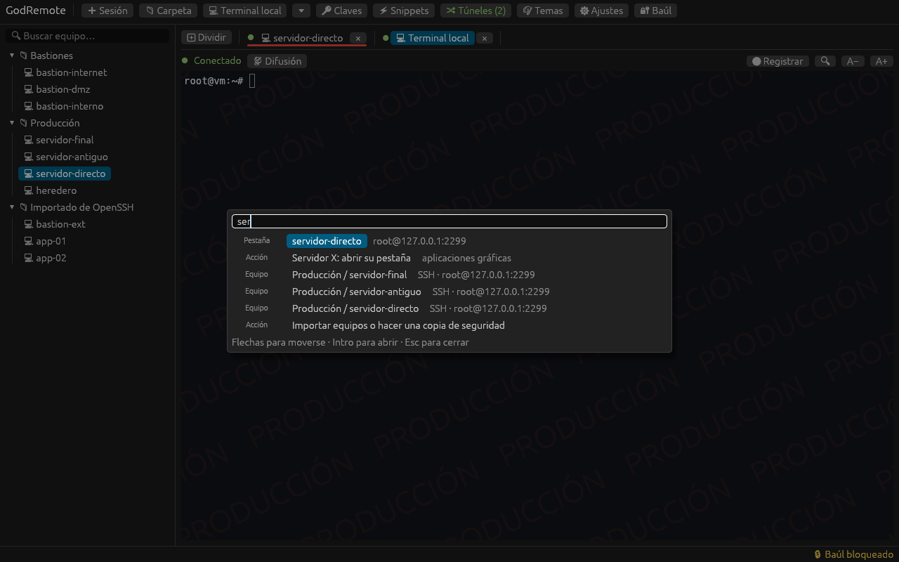
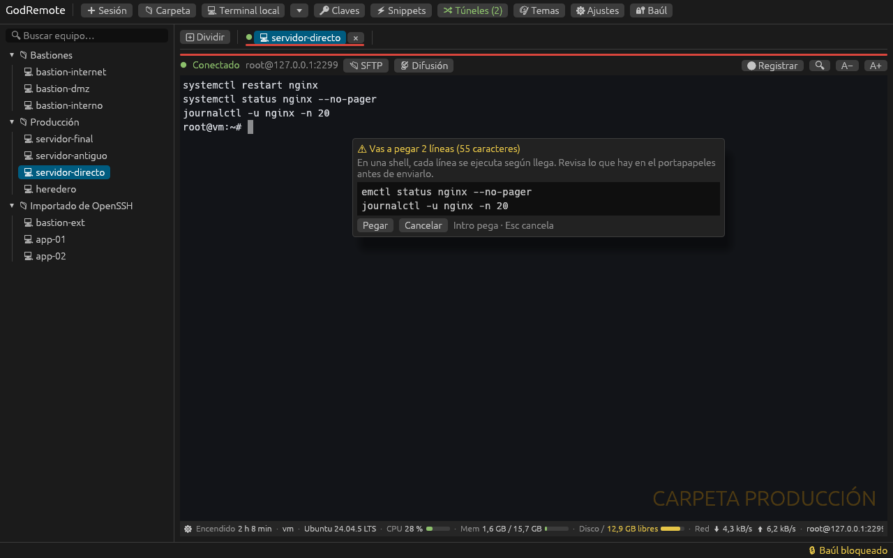
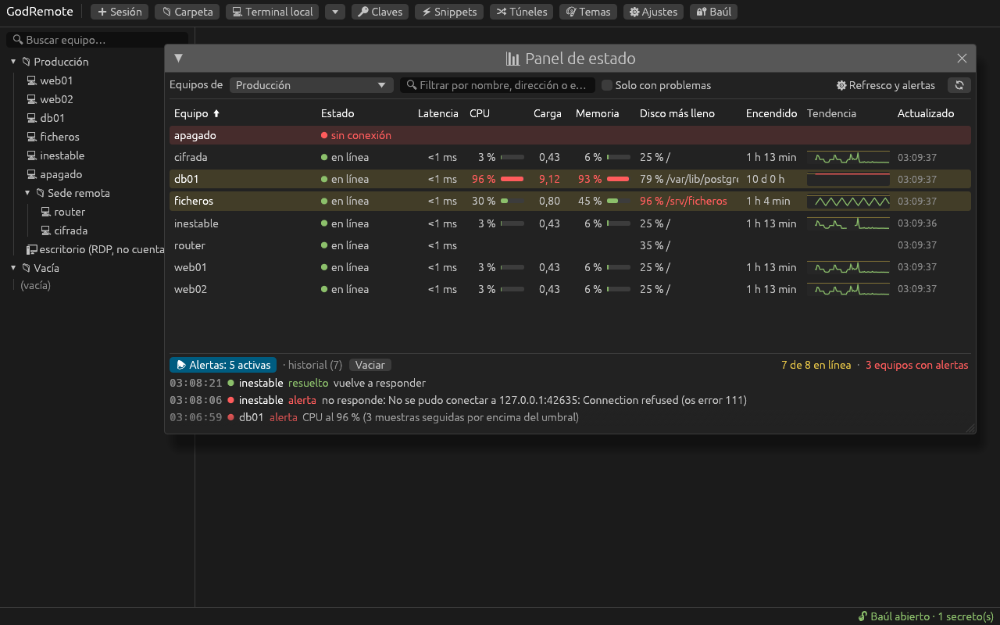
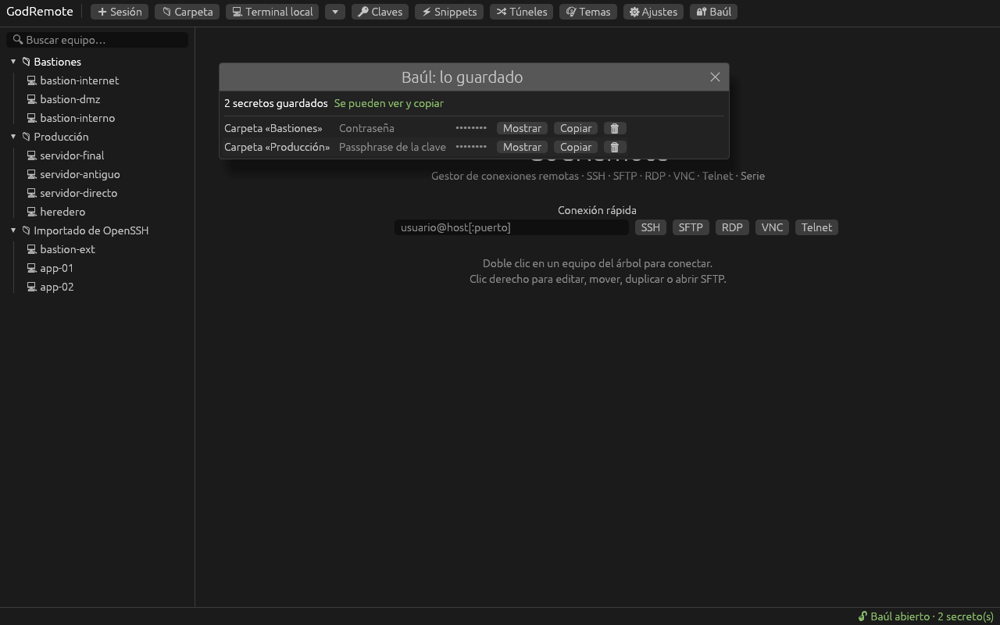
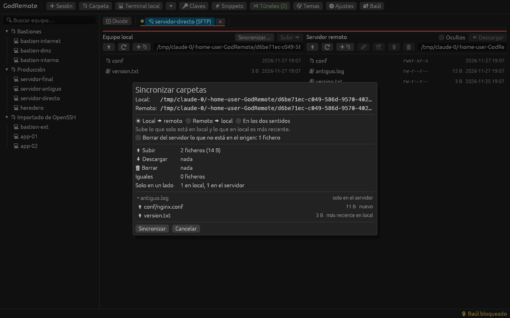
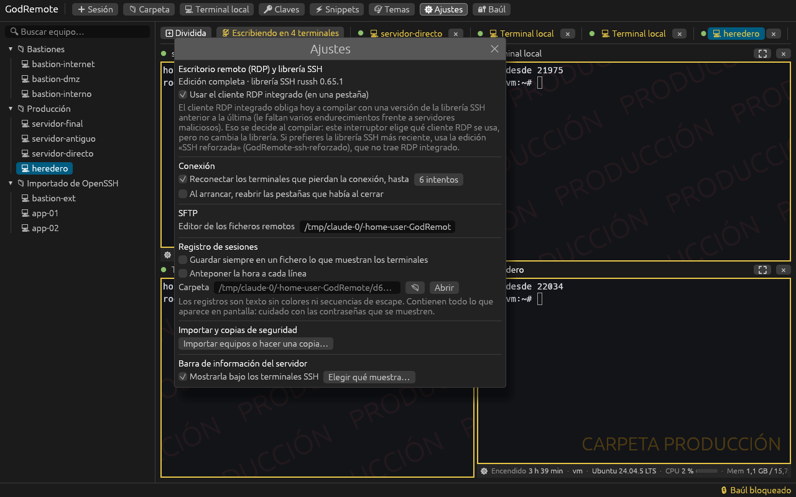

# GodRemote

Gestor de conexiones remotas escrito en Rust, al estilo de MobaXterm: un árbol
jerárquico de equipos, terminales con pestañas (SSH, Telnet, puerto serie),
explorador SFTP, escritorios remotos integrados (RDP y VNC), servidor X propio
para las aplicaciones gráficas remotas, túneles con su gestor, gestor de
claves, autenticación SSH con certificados, segundo factor (TOTP) y llaves
de seguridad, snippets con atajos, vista dividida y escritura simultánea en
varios terminales, disparadores, grabación de sesiones e historial de
órdenes, panel de estado de los equipos de una carpeta, ajustes heredados
por carpeta, importación desde otras herramientas, temas personalizables y
un baúl cifrado para las credenciales.

**Descargas:** en la
[última versión publicada](https://github.com/marc-mora/GodRemote/releases/latest)
hay, para cada una de las dos ediciones, instalador y `.zip` portátil para
Windows, aplicación universal (`.dmg`, Intel y Apple Silicon) para macOS y
paquete `.deb` y `.tar.gz` para Linux, con sus sumas en `SHA256SUMS.txt`. Los
ejecutables no están firmados: Windows y macOS avisan la primera vez.












## Qué hace

| Área | Funcionalidad |
|------|---------------|
| **Equipos** | Árbol de carpetas y subcarpetas, búsqueda, mover, duplicar, renombrar y eliminar. Conexión rápida `usuario@host[:puerto]`. |
| **Carpetas con valores** | Una carpeta puede dar a sus equipos el usuario, la autenticación, los saltos, el fondo del terminal y la barra de información. |
| **Importar y copiar** | Importa equipos de `~/.ssh/config`, PuTTY y MobaXterm. Copia de seguridad de toda la configuración en un solo fichero. |
| **SSH** | Terminal integrado (xterm-256color, historial de 10 000 líneas, selección y copiar/pegar, ratón para `htop`, `mc`, `vim`…). |
| **Autenticación SSH** | Contraseña, keyboard-interactive (PAM, códigos OTP), clave privada (OpenSSH, PEM, PuTTY `.ppk`), certificados OpenSSH, agente SSH (el de OpenSSH y, en Windows, Pageant) y llaves de seguridad FIDO2 a través del agente. El código del segundo factor (TOTP) puede rellenarse solo al conectar. |
| **Saltos (bastiones)** | Cada equipo tiene su lista ordenada de saltos SSH, como `ProxyJump a,b,c`. Vale para SSH, SFTP, Telnet, VNC y RDP integrado. |
| **Túneles** | Reenvío local (`-L`), remoto (`-R`) y dinámico SOCKS5 (`-D`). Ligados a una sesión (se abren y se cierran con su terminal) o guardados en el **gestor de túneles**, que los inicia y los detiene sin abrir un terminal. |
| **X11** | Servidor X propio, escrito en Rust e integrado: las aplicaciones gráficas remotas (clásicas, GTK 3, GTK 4, Qt 5, Tk, Motif, Java) se ven en una pestaña sin instalar VcXsrv, Xming ni XQuartz, con sus ventanas (mover, redimensionar, minimizar, maximizar) y el puntero que pide cada aplicación; de forma experimental, cada una en su propia ventana del sistema. También puede usarse el servidor X del sistema. Reenvío por SSH con cookie de autenticación. |
| **Agente y proxy** | Reenvío del agente SSH a un equipo (como `ssh -A`) y salida a través de un proxy HTTP o SOCKS5 de empresa. |
| **Verificación de host** | Usa `~/.ssh/known_hosts`, compartido con OpenSSH. Pregunta la primera vez y **rechaza** la conexión si la clave del servidor cambia. |
| **Terminal** | Búsqueda en pantalla e historial, registro de la sesión en un fichero, reconexión automática si se cae la red y reapertura de las pestañas al arrancar. Enlaces que se abren con `Ctrl+clic` y palabras resaltadas (errores en rojo, avisos en amarillo…) con reglas propias. |
| **Disparadores, grabación e historial** | Reglas que avisan —o, si se pide expresamente, contestan— cuando en la salida de un terminal aparece un texto, y aviso cuando termina una orden larga en una pestaña que no estás mirando. Grabación de la sesión con sus tiempos (asciicast, `.cast`) y reproductor integrado. Historial de las órdenes ejecutadas en cada equipo, con buscador. |
| **Pestañas** | Se reordenan arrastrando, se renombran con doble clic, llevan el color de su carpeta (producción en rojo) y avisan cuando hay salida nueva (o suena la campana) en una que no estás mirando. |
| **Paleta de órdenes** | `Ctrl+Mayús+P` y escribir: salta a un equipo, una pestaña, un snippet, un túnel o una acción. Atajos para cambiar, abrir y cerrar pestañas. |
| **Protecciones** | Pregunta antes de pegar varias líneas y antes de cerrar pestañas (o la aplicación) con sesiones conectadas. |
| **Automatización** | Órdenes que se envían solas al conectar a un equipo, y ejecutar una orden en todos los equipos de una carpeta recogiendo la salida y el código de cada uno. |
| **Vista dividida** | Varios terminales a la vez en mosaico, combinable con la difusión. |
| **SFTP** | Dos paneles (local / remoto), subida y descarga recursivas con progreso y cancelación, crear carpeta, renombrar y eliminar. Arrastrar y soltar desde el sistema, permisos (`chmod`), reanudar transferencias a medias y sincronizar carpetas con un plan previo. Se puede abrir sobre la conexión SSH de un terminal, seguir su carpeta y editar ficheros remotos con el editor local. Fechas en hora local. |
| **RDP** | Cliente integrado en una pestaña, o el cliente externo del sistema (FreeRDP / `mstsc`). |
| **VNC** | Cliente integrado (RFB 3.3–3.8; Raw, CopyRect, Hextile, ZRLE; contraseña VNC). |
| **Telnet y serie** | Terminales para Telnet y para puertos serie (`COM3`, `/dev/ttyUSB0`…). |
| **Snippets** | Textos y órdenes con nombre que se envían al terminal desde el menú o con un atajo de teclado propio (`Ctrl+Alt+D`, `F6`…). Se escriben a mano o se graban tecleando, y admiten variables (`{{host}}`, `{{?Pregunta}}`). |
| **Difusión** | Lo que escribes en un terminal se envía a la vez a todos los terminales abiertos o solo a los que elijas. |
| **Barra de información** | Bajo cada terminal SSH: nombre del servidor, sistema, tiempo encendido, CPU, memoria, disco, red… Se elige qué se muestra, en qué orden y cada cuánto se actualiza. |
| **Panel de estado** | Todos los equipos SSH de una carpeta a la vez: conexión, latencia, CPU, carga, memoria, disco más lleno, tiempo encendido y minigráfica de tendencia; alertas por umbrales con historial. |
| **Temas** | Claro u oscuro según el sistema operativo, y cambia con él. Cinco temas integrados y editor en vivo de colores, tipos y tamaños de letra, interlineados, separaciones y bordes. Importar y exportar en JSON. |
| **Fondo del terminal** | Un texto, un dibujo ASCII o una imagen detrás del texto, con la opacidad que se quiera. Por tema o por equipo. |
| **Claves** | Lista las claves de `~/.ssh` y las propias, con sus certificados, y lo que hay cargado en el agente; genera pares Ed25519 / ECDSA (con passphrase opcional), importa claves y copia la pública. |
| **Credenciales** | Baúl cifrado con contraseña maestra (Argon2id + XChaCha20-Poly1305). Las contraseñas solo se guardan tras una autenticación correcta. Se bloquea solo tras un rato sin actividad y tiene un visor para revisar y borrar lo guardado. |
| **Terminal local** | Con la shell que elijas: PowerShell, cmd, WSL o Git Bash en Windows; bash, zsh, fish… en Linux y macOS. |

## Compilar y ejecutar

Hace falta Rust 1.88 o posterior, un compilador de C, CMake y NASM (los usan
las librerías criptográficas).

```bash
cargo run --release
```

En Linux se necesitan además las librerías de escritorio habituales. En
Debian/Ubuntu:

```bash
sudo apt install build-essential cmake libxkbcommon-x11-0 libgl1 libegl1
```

### Compilación y pruebas automáticas

Cada cambio que se sube pasa por GitHub Actions (`.github/workflows/ci.yml`):

- **Linux**: formato, todas las pruebas de las dos ediciones —incluidas las
  que necesitan servidores reales (`sshd`, `telnetd`, `x11vnc`, FreeRDP,
  clientes X)— y `clippy` sin avisos.
- **Windows y macOS**: compilación nativa y las pruebas que no dependen de
  servidores de Unix.
- **En los tres**, la aplicación de verdad: se abre, pinta su ventana, guarda
  una captura (queda como artefacto de la ejecución) y se cierra. Es lo que
  hace `GODREMOTE_CAPTURA=fichero.png godremote`, y el código de salida dice
  si la ventana llegó a pintarse.

Al crear una etiqueta `vX.Y.Z` se compilan además los ejecutables nativos
de las dos ediciones para Windows, Linux y macOS, y se publican como
**Release** en GitHub. La etiqueta se puede empujar con `git` o crear desde
la web (*Releases → Draft a new release*, escribiendo la etiqueta nueva y
publicando): en ese caso los ejecutables se añaden a la versión recién
creada. Si existe `docs/versiones/vX.Y.Z.md`, hace de notas de la versión.
Los mismos ejecutables se pueden pedir sin publicar
una versión —se descargan como artefactos de la ejecución, en la pestaña
*Actions*—: a mano desde esa pestaña, o poniendo `[ejecutables]` en el
mensaje de un commit.

Los paquetes los prepara `empaquetado/empaquetar.sh` a partir de los
ejecutables ya compilados (sirve igual a mano): `.tar.gz` y `.deb` en Linux
—compilado en una Ubuntu antigua para que valga en más distribuciones—,
`.tar.gz` y `.dmg` con la aplicación universal en macOS, y `.zip` e
instalador por usuario (Inno Setup, sin permisos de administrador) en
Windows. Antes de empaquetar, cada ejecutable pasa la prueba de arranque.

### Con qué se pinta la ventana

En Linux y macOS, con OpenGL. En **Windows, con DirectX 12**: funciona
también donde no hay controlador de OpenGL (máquinas virtuales, servidores
sin tarjeta gráfica, algunas sesiones de escritorio remoto), porque DirectX
trae un modo por software. Si DirectX no arranca se prueba OpenGL, y si
ninguno sirve un cuadro de diálogo dice por qué. La variable de entorno
`GODREMOTE_RENDER` (`directx` u `opengl`) elige uno a mano.

### Ejecutable de Windows desde Linux

Con `mingw-w64` y `nasm` instalados:

```bash
rustup target add x86_64-pc-windows-gnu
```

```bash
cargo build --release --target x86_64-pc-windows-gnu
```

El resultado es un único `godremote.exe` que solo depende de DLL del sistema.

### Dos ediciones: completa y «SSH reforzada»

El cliente RDP integrado depende de IronRDP, cuyas dependencias fijan una
versión preliminar de `rsa` que impide a Cargo elegir la última versión de
la librería SSH (russh). Eso se decide al compilar, así que hay dos
ediciones del mismo código:

| Edición | RDP integrado | Librería SSH | Cómo se compila |
|---------|---------------|--------------|-----------------|
| **Completa** (`godremote`) | Sí | russh 0.65.1 | `cargo build --release` |
| **SSH reforzada** (`godremote-reforzado`) | No (RDP con el cliente externo) | russh 0.65.4 | `cargo build --release --manifest-path reforzado/Cargo.toml --target-dir target` |

Las dos se descargan ya compiladas, para Windows, Linux y macOS, de la
[página de versiones](https://github.com/marc-mora/GodRemote/releases)
(`GodRemote-…` es la completa y `GodRemote-ssh-reforzado-…` la SSH
reforzada). Usan la misma carpeta de configuración, así que se puede pasar
de una a otra.

A la 0.65.1 le faltan varios endurecimientos frente a servidores SSH
maliciosos publicados entre la 0.65.2 y la 0.65.4. Si no usas el RDP
integrado, o te conectas a servidores en los que no confías del todo, usa la
edición reforzada. **⚙ Ajustes** dice qué edición y qué versión de la
librería estás usando; en la completa, además, permite desactivar el RDP
integrado para que RDP se abra siempre con el cliente externo (eso cambia el
cliente, no la librería).

`reforzado/` tiene su propio `Cargo.toml` y `Cargo.lock` porque un
`Cargo.lock` incluye también las dependencias opcionales; una prueba
comprueba que las dos listas de dependencias no se separan. Cuando IronRDP
deje de fijar esa versión bastará `cargo update -p russh` y sobrará la
segunda edición.

## Uso

- **➕ Sesión** crea un equipo; **📁 Carpeta** crea una carpeta dentro de la
  seleccionada.
- **Doble clic** sobre un equipo conecta. **Clic derecho** ofrece editar,
  duplicar, mover, eliminar y las formas alternativas de abrirlo.
- En el terminal: `Ctrl+C` copia si hay texto seleccionado y, si no, envía la
  interrupción; `Ctrl+V` pega; `Mayús+RePág/AvPág` o la rueda recorren el
  historial. Cuando una aplicación remota usa el ratón, `Mayús` devuelve el
  ratón a la selección local.
- En las pestañas: **arrastra** una para cambiarla de sitio, **doble clic**
  para renombrarla (Intro guarda, Escape cancela), clic central para
  cerrarla y **clic derecho** para duplicarla, llevarla al principio o al
  final y cerrar las demás o las de su derecha. El nombre que le pongas se
  conserva al reabrir las pestañas.
- En SFTP: doble clic entra en una carpeta o transfiere un fichero;
  `Ctrl+clic` selecciona varios.
- En un escritorio remoto: el teclado y el ratón van al equipo remoto mientras
  la pestaña tiene el foco. `Ctrl+V` envía antes el portapapeles local. Los
  botones **Ctrl+Alt+Supr** y **Win** envían esas teclas, que el sistema local
  no deja capturar.

### Paleta de órdenes y atajos

**Ctrl+Mayús+P** abre una caja de búsqueda sobre todo lo que se puede abrir:
pestañas abiertas, equipos del árbol (por nombre, carpeta, usuario o
dirección), snippets, túneles, las últimas órdenes del historial del equipo
de la pestaña activa y acciones (terminal local, vista dividida, difusión,
ajustes…). Se escribe parte del nombre —varias palabras, sin
acentos, o sus iniciales salteadas: «prd» encuentra «producción»—, se elige
con las flechas e Intro lo abre.

| Atajo | Hace |
|-------|------|
| `Ctrl+Mayús+P` | Paleta de órdenes |
| `Ctrl+Tab` · `Ctrl+AvPág` | Pestaña siguiente |
| `Ctrl+Mayús+Tab` · `Ctrl+RePág` | Pestaña anterior |
| `Ctrl+Mayús+T` | Terminal local nuevo |
| `Ctrl+Mayús+W` | Cerrar la pestaña |
| `Ctrl+Mayús+F` | Buscar en el terminal |

Todos llevan Mayús o una tecla que la shell no usa con Ctrl: `Ctrl+W`,
`Ctrl+T` y las demás combinaciones de la shell siguen llegando al terminal.
Se pueden desactivar en **⚙ Ajustes**, y un snippet no puede usar ninguno.

### Protecciones

- **Pegar varias líneas**: antes de enviarlas, el terminal enseña lo que hay
  en el portapapeles y pregunta (Intro pega, Esc cancela). En una shell cada
  línea se ejecuta según llega, así que un pegado equivocado puede ser caro.
- **Cerrar con sesiones vivas**: al cerrar una pestaña conectada —o varias
  de golpe, o la propia aplicación con sesiones o túneles en marcha— se
  pregunta antes. El foco va a «Cancelar»: una tecla de más no cierra nada.
- **Color por carpeta**: en la ficha de una carpeta (o de un equipo) se
  elige un color; sus pestañas lo llevan debajo del título y en una franja
  sobre el terminal. Rojo para producción, por ejemplo.

Las dos preguntas se pueden quitar en **⚙ Ajustes**.

### Órdenes al conectar y ejecutar en varios equipos

- **Órdenes al conectar**: en la ficha de un equipo SSH (Avanzado) se
  escriben las órdenes que deben teclearse solas en cuanto la shell termina
  de saludar, también al reconectar. Admiten las variables de los snippets
  (`{{host}}`, `{{usuario}}`, `{{nombre}}`, `{{fecha}}`…).
- **Ejecutar en varios equipos**: clic derecho sobre una carpeta →
  **Ejecutar una orden en sus equipos…** (o desde la paleta). Se eligen los
  equipos SSH, se escribe la orden (o se parte de un snippet) y GodRemote la
  lanza en todos, unos pocos a la vez, mostrando de cada uno su salida, su
  código y lo que tardó. Se puede cancelar, copiar la salida de uno o de
  todos y guardarla en un fichero. Con más de un equipo se pide una
  confirmación más.

### Carpetas que dan valores a sus equipos

Clic derecho sobre una carpeta → **Editar carpeta…** permite definir, para
los equipos que contiene (y los de sus subcarpetas):

- el **usuario** y el **fondo del terminal**, que se aplican a los equipos
  que no tengan el suyo;
- la **autenticación** (con su contraseña o passphrase en el baúl) y los
  **saltos**, que usan los equipos que marcan «la de la carpeta» en su ficha
  (los equipos nuevos lo marcan solos);
- desactivar la **barra de información** en todos ellos;
- el **color** con el que se marcan sus pestañas.

La ficha de cada equipo indica qué hereda y de qué carpeta. Si una
subcarpeta define un valor, manda sobre el de la carpeta de arriba.

### Túneles, salto y X11

En el editor de una sesión:

- **Saltos (bastiones SSH)**: añade, en orden, las sesiones SSH del árbol por
  las que hay que pasar. Se conecta a la primera, desde ella a la segunda, y
  así hasta el destino; el editor muestra el camino resultante. Si un salto
  necesita a su vez otros, se intercalan solos. Está disponible para SSH,
  SFTP, Telnet, VNC y RDP integrado (no con el cliente RDP externo).
- **X11**: marca «Reenviar aplicaciones gráficas (X11)» para que las
  aplicaciones gráficas que lances en ese equipo se vean aquí, en el servidor
  X integrado o en el del sistema (véase «Servidor X integrado»).
- **Túneles**: tipo, dirección y puerto de escucha, y destino. La cabecera del
  terminal muestra cuántos están activos. Estos túneles viven mientras viva
  el terminal de la sesión.
- **Reenviar el agente SSH**: como `ssh -A`. Las claves de tu agente
  (OpenSSH en Linux, macOS y Windows; en Windows, también Pageant) quedan
  disponibles en ese equipo para saltar desde él a otros con `ssh` o `git`,
  sin copiar ninguna clave.

### Más formas de autenticarse por SSH

Además de la contraseña y la clave privada:

- **Certificados OpenSSH**: con «Clave privada», si junto a la clave hay un
  `<clave>-cert.pub` (lo que deja `ssh-keygen -s`), se presenta el
  certificado al servidor, como hace OpenSSH. El campo «certificado» del
  editor permite indicar otro fichero y resume el que se va a usar
  (identidad, usuarios para los que vale y validez). Si el servidor no lo
  acepta, o está caducado, se prueba la clave sola, y el aviso o el error
  dicen qué pasó: caducado, de otra clave, el usuario no está entre sus
  principales, o autoridad en la que el servidor no confía. **🔑 Claves**
  muestra de cada certificado la identidad, los principales, la validez y
  la autoridad que lo firmó, y marca en rojo los caducados. Importar o
  borrar una clave se lleva su certificado. Los certificados cargados en el
  agente también se ofrecen.
- **Segundo factor (TOTP)**: en el editor del equipo, «Segundo factor»
  admite el secreto TOTP en base32 o la dirección `otpauth://…` del código
  QR (SHA-1/256/512, de 6 a 8 cifras, cualquier periodo). Se guarda cifrado
  en el baúl, nunca en claro. Con el baúl abierto el editor enseña el código
  actual, lo que le queda y un botón para copiarlo. Con «Rellenar el código
  solo al conectar» (se marca al escribir un secreto), cuando el servidor
  pide un código de verificación por keyboard-interactive GodRemote lo
  contesta. Con el baúl bloqueado, o si el servidor no acepta el código, se
  pregunta como siempre. Vale tanto si el servidor pide contraseña y código
  juntos (PAM) como en dos pasos (con `AuthenticationMethods` en
  `publickey,keyboard-interactive` o `password,keyboard-interactive`).
  Nunca se envía dos veces el mismo código: si acabas de abrir otra conexión
  al mismo equipo, se espera al siguiente.
- **Agente SSH y Pageant**: «Agente SSH» usa el agente de OpenSSH y, en
  Windows, también Pageant (PuTTY). **⚙ Ajustes → Conexión → Agente SSH**
  (solo aparece en Windows) elige entre automático (OpenSSH y, si no está o
  no tiene claves, Pageant), solo OpenSSH o solo Pageant. El reenvío del
  agente (`ssh -A`) usa el mismo. **🔑 Claves** lista lo que hay cargado en
  el agente. Lo de Pageant compila para Windows, pero no se ha ejecutado
  (véase «Limitaciones conocidas»).
- **Llaves de seguridad FIDO2** (`ed25519-sk`, `ecdsa-sk`): se usan a través
  del agente SSH; `ssh-add` las carga y el agente pide la firma a la llave.
  Con «Agente SSH» no hay que hacer nada más. También se puede elegir el
  fichero de la llave como «Clave privada»: GodRemote busca esa clave en el
  agente. Antes de firmar avisa de que hay que tocar la llave. **🔑 Claves**
  las marca como «llave de seguridad».

### Proxy de salida

Si la red no deja salir directamente, **⚙ Ajustes → Proxy de salida** hace
que la primera conexión hacia cada equipo pase por un proxy **HTTP**
(`CONNECT`) o **SOCKS5**, con usuario y contraseña si los pide (la
contraseña se guarda en el baúl). Vale para SSH, SFTP, Telnet, VNC y RDP
integrado, para el primer salto de una cadena y para los túneles del gestor.

- Las direcciones de este mismo equipo (`localhost`, `127.0.0.1`) nunca
  pasan por el proxy.
- **Sin proxy para** admite excepciones separadas por comas: un nombre, un
  final de dominio (`.interno`) o un comienzo de dirección (`10.`).
- Cada equipo puede pedir conexión directa en su ficha (Avanzado).
- El nombre del equipo lo resuelve el proxy, no este equipo.

### Servidor X integrado

GodRemote trae su propio servidor X, escrito en Rust: no hay que instalar
ni arrancar nada aparte. En **⚙ Ajustes → Aplicaciones gráficas (X11)** se
elige entre el **servidor X integrado** (por defecto en Windows) y el **del
sistema** (por defecto en Linux y macOS: el escritorio, VcXsrv, Xming,
XQuartz…).

Con el integrado:

- Conecta a un equipo SSH que tenga marcado el reenvío X11 y lanza una
  aplicación gráfica desde su terminal (`xterm &`, `xclock &`…). El servidor
  arranca con la primera aplicación y se abre la pestaña **Servidor X**, con
  todas las ventanas dentro.
- Cada ventana lleva su barra de título: se mueve arrastrándola, se
  redimensiona por cualquier borde o esquina, se **maximiza** con su botón o
  con doble clic en la barra (y se restaura igual), se trae al frente con un
  clic y se cierra con su aspa. Los diálogos salen centrados sobre su
  ventana. El teclado va a la ventana que tiene el foco; el ratón, a la que
  está debajo.
- El botón de **minimizar** de la barra deja la ventana como una ficha en
  una tira al pie de la pantalla X, y vuelve con un clic. También se atiende
  a las aplicaciones que se minimizan o se restauran solas. Las ventanas
  maximizadas dejan sitio a la tira.
- El **puntero** es el que pide la aplicación: los de forma (texto, mano,
  espera, redimensionar…) con el cursor del sistema, y los de imagen o
  animados dibujados tal cual. Sobre los bordes de las ventanas aparece el
  de redimensionar.
- La pantalla se ajusta sola al tamaño de la pestaña, y las ventanas
  maximizadas la siguen.
- El portapapeles va en los dos sentidos: lo que selecciones en una
  aplicación llega al portapapeles local, y el portapapeles local se
  entrega a las aplicaciones al entrar en la pestaña. Dentro se pega como
  en X: con el botón central o, en `xterm`, con `Mayús+Insert`.
- Cerrar la pestaña **para el servidor** y cierra las aplicaciones que
  tuviera; vuelve a arrancar solo con la siguiente.
- **Aceptar también programas de este equipo** hace que escuche en
  `127.0.0.1`; la pestaña muestra el `DISPLAY` que hay que usar (por ejemplo,
  desde WSL o desde un terminal local).
- **Cada aplicación en su ventana** (experimental): en **⚙ Ajustes →
  Aplicaciones gráficas (X11) → Aplicaciones** se elige «en una pestaña»
  (por defecto) o «cada una en su ventana». Con lo segundo, cada ventana de
  las aplicaciones remotas sale como una ventana más del sistema, con su
  título y su marco: se mueve, se redimensiona y se cierra como cualquier
  otra, y los menús y listas desplegables salen en su sitio. La pestaña
  **Servidor X** sigue ahí como mando: cerrarla para el servidor y cierra
  las aplicaciones. El cambio vale para la próxima vez que arranque el
  servidor. Solo se ha probado en Linux con X11; en Wayland no está
  disponible y las aplicaciones siguen en la pestaña.

El servidor entiende el protocolo X11 básico (*core*: ventanas, dibujo,
fuentes, colores, teclado, ratón y selecciones) y las extensiones que piden
las aplicaciones actuales: **RENDER** (composición con transparencia y texto
suavizado: la usan GTK, Xft y Java), **SHAPE** (ventanas con forma),
**RANDR** (para que sepan el tamaño de la pantalla y cuándo cambia),
**XKEYBOARD** (XKB: el mapa y el estado del teclado) y **XInput 2.0**
(teclado y ratón como dispositivos). Con las dos últimas arrancan las
aplicaciones **GTK 4**.

A las aplicaciones GTK 4 conviene lanzarlas con `GSK_RENDERER=cairo` (por
ejemplo, `GSK_RENDERER=cairo gtk4-demo &`): sin ello pintan con OpenGL por
software, mandan la ventana entera en cada fotograma y, al maximizar o
redimensionar, pueden dejar zonas sin pintar.

| Aplicaciones | Estado |
|--------------|--------|
| Clásicas (`xterm` —también con `-fa`—, `xclock`, `xcalc`, `xeyes`, `xlogo`, `xmessage`, `xfontsel`, `xev`) y utilidades (`xdpyinfo`, `xprop`, `xwininfo`, `xlsfonts`, `xrandr`, `wmctrl`) | Probadas |
| `xdotool` | Encuentra e inspecciona ventanas; no puede teclear ni pulsar (falta XTEST) |
| **GTK 3** | Probada: teclado (con Ñ y €), ratón, menús, portapapeles en los dos sentidos |
| **GTK 4** | Probada (`zenity` y `gtk4-widget-factory`; `gtk4-demo`, solo a ojo): teclado (con Ñ y €), ratón, menús emergentes y rueda; mejor con `GSK_RENDERER=cairo` |
| **Qt 5** | Probada: teclado, ratón, portapapeles, y minimizarse y volver |
| **Tk**, **Motif** | Probadas: botones, menús, diálogos y tecleo |
| **Java (Swing)** | Probada: botones y tecleo; el texto sale sin suavizar |
| Qt 6, navegadores (Chromium, Electron, Firefox), LibreOffice | Sin probar |
| Lo que necesite OpenGL (GLX) | No funciona |

Para lo que no funcione aquí sigue estando el servidor X del sistema.

Las aplicaciones remotas no son de fiar, y el servidor está hecho contando
con ello: una petición mal formada no puede tumbar GodRemote (como mucho se
expulsa a la aplicación que la envía) y la memoria que puede hacerle
reservar está acotada.

### Gestor de túneles

**🔀 Túneles**, en la barra superior, guarda túneles que no dependen de
ningún terminal. Cada uno tiene un nombre, el equipo SSH del árbol por el que
pasa (con sus saltos y su autenticación, heredada o propia), el tipo (`-L`,
`-R` o `-D`), dónde escucha y a dónde lleva.

- **▶ Iniciar** abre una conexión SSH solo para ese túnel; **⏹ Detener** la
  cierra. El botón de la barra muestra cuántos hay en marcha, en verde, o en
  rojo si alguno ha fallado.
- **Iniciarlo al abrir GodRemote** lo arranca solo (después de desbloquear el
  baúl, para no pedir contraseñas que ya están guardadas).
- Si la conexión se cae, el túnel se vuelve a levantar solo con las mismas
  esperas y el mismo límite de intentos que los terminales (**⚙ Ajustes**).
- Los túneles se guardan en `tunnels.json` y entran en la copia de seguridad.

### Barra de información del servidor

Bajo cada terminal SSH hay una barra con el estado del servidor. **📊 Barra de
estado** (o el engranaje de la propia barra) abre sus ajustes:

- **Qué se muestra y en qué orden**: nombre de la sesión, nombre del servidor,
  usuario y dirección, direcciones IP, sistema operativo, kernel, tiempo
  encendido, carga media, uso de CPU, memoria, intercambio, espacio libre en
  disco, tráfico de red, usuarios conectados, procesos y hora del servidor.
- **Discos**: las rutas cuyo espacio libre interesa (`/, /home, /var`).
- **Actualizar cada** tantos segundos, barritas de uso, y a partir de qué
  porcentaje un valor se pinta en color de aviso o de error.

Los datos se piden por un canal aparte de la misma conexión SSH: no se
escribe nada en tu terminal ni se abre otra conexión. Hace falta que el
servidor tenga una shell POSIX (`sh`); el uso de CPU, memoria y red sale de
`/proc`, así que en sistemas que no son Linux solo aparecen el nombre, el
sistema y el disco. En equipos donde no proceda (routers, conmutadores) se
desactiva en la ficha de la sesión, en «Terminal: barra de información y
fondo».

### Panel de estado de una carpeta

Clic derecho sobre una carpeta → **📊 Panel de estado** (o, en la paleta,
«Panel de estado de los equipos de una carpeta», que toma la carpeta
seleccionada). Se abre una ventana que vigila a la vez todos los equipos SSH
de la carpeta y de sus subcarpetas:

- **Qué muestra de cada equipo**: estado de la conexión, latencia, uso de
  CPU, carga, memoria, el disco más lleno, tiempo encendido, una minigráfica
  de los últimos minutos (CPU o carga) y la hora del último dato. Con el
  ratón sobre una fila se ve el detalle: carga a 1, 5 y 15 minutos, memoria,
  todos los discos y el error si lo hay. Lo que un equipo no da (otro Unix,
  un BusyBox recortado) queda vacío.
- **Refresco**: cada 10 segundos de fábrica. Cada equipo conserva su
  conexión entre refrescos; por ella corre una consulta ligera (lee `/proc`
  y llama a `df`) y se mide la latencia con un sondeo SSH. Al cerrar la
  ventana se cierran todas las conexiones. Plegada (el triángulo del título)
  sigue vigilando y avisando, pero no repinta.
- **Tabla**: pulsar el título de una columna ordena por ella, y otra vez, al
  revés. La caja filtra por nombre, dirección, estado o alerta. «Solo con
  problemas» deja lo que va mal. Doble clic abre el terminal del equipo;
  botón derecho → «Reintentar ahora».
- **Conexiones**: como mucho 32 abiertas a la vez (ajustable), y se abren de
  cuatro en cuatro. Si la carpeta tiene más equipos que el tope, se turnan:
  cada uno conecta, da sus datos y cede el sitio.
- **Si un equipo cae** se reintenta solo, con esperas de 2, 5, 10, 20, 30,
  60 y 120 segundos. No se insiste si lo que falla es la autenticación o la
  clave del servidor.
- **Credenciales**: las contraseñas o passphrases que no estén en el baúl, y
  las claves de servidores desconocidos, se preguntan como en el resto de la
  aplicación al abrir el panel o al pulsar «Reintentar ahora». Si se
  cancela, el equipo queda en «falta credencial» y los demás siguen. Las
  reconexiones automáticas nunca preguntan. Al bloquearse el baúl el panel
  olvida las credenciales; al desbloquearlo, los equipos que esperaban una
  se reintentan solos.
- **Alertas** (botón «⚙ Refresco y alertas»):
  - CPU por encima del 90 %, o carga por encima de 2 por núcleo, durante 3
    muestras seguidas;
  - memoria por encima del 90 %;
  - disco más lleno por encima del 90 %;
  - equipo inalcanzable (falla el intento de conectar) o sin acceso (falta
    una credencial, o el servidor la rechaza).

  La fila se resalta y el dato va en rojo. La aplicación avisa en su barra
  de estado, al pie de la ventana, al saltar una alerta y al resolverse, no
  en cada muestra; las que coinciden van en un solo aviso. Abajo queda el
  historial de las últimas 200. Cada umbral se puede cambiar o desactivar;
  se guardan en `settings.json` (`panel_estado`).

### Temas

De fábrica GodRemote **sigue al sistema operativo**: usa el tema «GodRemote
Claro» si el sistema está en modo claro y «GodRemote Oscuro» si está en modo
oscuro, y cambia solo cuando cambia el sistema (a los pocos segundos; hasta
unos veinte si la ventana está en reposo). **🎨 Temas** abre el gestor:

- **Seguir al sistema (claro u oscuro)** activa o desactiva ese modo. Con él
  activado se elige qué tema va con cada modo —cualquiera de la lista, también
  los tuyos— y se ve en cuál está el sistema.
- Elige un tema de la lista y se aplica al instante. Siguiendo al sistema,
  queda como el tema del modo en que está en ese momento; sin seguirlo, es el
  tema fijo.
- **Duplicar y editar** abre el editor, con todo agrupado por secciones. Los
  cambios se ven en vivo:
  - **Colores** de la interfaz y del terminal, incluidos los 16 ANSI.
  - **Letra e interlineado**: tamaño de la letra de la interfaz, títulos,
    texto pequeño, botones, terminal y barra de información; interlineado de
    la interfaz y del terminal, y separación entre las letras del terminal.
  - **Separaciones y forma**: separación horizontal y vertical entre
    elementos, relleno de los botones, alto mínimo de filas y botones,
    redondeo, grosor de bordes, márgenes de ventanas y menús, sangría del
    árbol, ancho de las barras de desplazamiento y margen del terminal.
  - **Fondo del terminal** (véase más abajo).
- **Descargar tema base** guarda un JSON legible para modificarlo con
  cualquier editor de texto; **Importar un tema** lo carga (también se puede
  soltar el fichero sobre la ventana).

El modo del sistema se lee del registro en Windows («modo de aplicación» de
*Personalización → Colores*), de las preferencias en macOS y, en Linux, del
portal de escritorio (`org.freedesktop.appearance`), o en su defecto de la
configuración de GNOME/GTK o de KDE. Si no se puede averiguar —un gestor de
ventanas sin escritorio, por ejemplo— se usa el tema fijo. Quien ya había
elegido un tema en una versión anterior lo conserva: el modo automático solo
se activa solo si seguía con el de fábrica.

Un tema es un JSON como este; los campos que falten se toman del tema base
(el fichero que da «Descargar tema base» los trae todos):

```json
{
  "nombre": "Mi tema",
  "oscuro": true,
  "interfaz": { "fondo": "#1b1b1b", "acento": "#d35400", "texto": "#c4c4c4" },
  "terminal": { "fondo": "#1a120b", "texto": "#ffd9a8", "ansi": { "rojo": "#cc6666" } },
  "letra": { "interfaz": 14, "terminal": 16, "interlineado_terminal": 1.2 },
  "forma": { "redondeo": 4, "espaciado": 8, "relleno_botones_vertical": 4 },
  "fondo_terminal": { "tipo": "texto", "texto": "PRODUCCIÓN", "color": "#ff5c5c",
                      "opacidad": 15, "giro": -25, "repetir": true }
}
```

### Fondo del terminal

En el editor de temas, **Fondo del terminal** permite poner detrás del texto:

- un **texto** (por ejemplo `PRODUCCIÓN`), con su tamaño, color y giro, una
  sola vez o repetido por todo el terminal como una marca de agua;
- un **dibujo ASCII**, escrito, pegado o cargado de un fichero de texto;
- una **imagen** (PNG, JPEG, GIF, BMP o WebP), a su tamaño, ajustada,
  rellenando, estirada o en mosaico.

En los tres casos se elige la **opacidad** (de 0 a 100 %) y la posición. La
imagen se guarda dentro del propio tema, así que al exportarlo viaja con él;
las muy grandes se reducen al cargarlas.

Cada equipo puede tener además **su propio fondo**, que sustituye al del
tema: en la ficha de la sesión, «Terminal: barra de información y fondo» →
«Fondo propio para este equipo». Sirve para distinguir de un vistazo los
servidores delicados.

### Vista dividida

**⊞ Dividir**, a la izquierda de las pestañas, reparte los terminales en
mosaico: todos los abiertos o solo los que elijas, con las columnas que
quieras. Un clic en un terminal le da el teclado (se marca con un marco);
doble clic en su título, o su botón de ampliar, lo deja a pantalla completa.
Con la vista dividida activa, el botón **📡 Difusión** pasa a la barra de
pestañas: es la forma cómoda de escribir en varios servidores viendo lo que
responde cada uno.

### Buscar, registrar y reconectar

- **Buscar** (`Ctrl+Mayús+F` o el botón 🔍): busca en la pantalla y en todo
  el historial, resalta las coincidencias y salta entre ellas con Intro y
  Mayús+Intro.
- **⏺ Registrar** guarda en un fichero de texto lo que vaya mostrando el
  terminal, sin colores ni secuencias de escape. En **⚙ Ajustes** se puede
  pedir que se registre siempre, con la hora en cada línea, y elegir la
  carpeta. Para guardar la sesión con sus tiempos y volver a verla, véase
  «Grabar y reproducir sesiones».
- **Reconexión**: si un terminal pierde la conexión, se vuelve a conectar
  solo, con esperas crecientes, conservando lo que había en pantalla. No se
  reintenta si lo que falla es la contraseña o la clave, ni si cierras tú la
  sesión. Se ajusta (o se desactiva) en **⚙ Ajustes**, donde también se
  puede pedir que al arrancar se reabran las pestañas de la última vez.

### Enlaces, palabras resaltadas y avisos de actividad

- **Enlaces**: las direcciones `http://`, `https://`, `ftp://` y `www.…` que
  aparezcan en el terminal se subrayan al pasar el ratón y se abren en el
  navegador con **Ctrl+clic**, o con el botón derecho (**Abrir enlace** /
  **Copiar enlace**). Un enlace partido en dos filas se reconoce entero.
- **Palabras resaltadas**: `error`, `failed`, `denied`… salen en rojo;
  `warning`, `timeout`… en amarillo; `ok`, `success`, `done`… en verde. En
  **⚙ Ajustes** se cambian las listas, se añaden reglas con su color (uno
  de la paleta del tema o uno propio) o se apaga todo. Solo cuentan las
  palabras enteras, sin distinguir mayúsculas, y lo que el servidor ya haya
  coloreado se deja como está.
- **Actividad**: una pestaña de terminal que recibe salida mientras miras
  otra se destaca; si además ha sonado la campana, lleva un 🔔. Se quita al
  abrirla, y se puede desactivar en **⚙ Ajustes**.

### Disparadores y aviso de fin de orden

**🛠 Herramientas → Disparadores**, en la barra superior (o «Disparadores»
en la paleta), gestiona reglas «cuando en la salida de un terminal aparezca
este texto, haz algo»:

- **Texto**: literal o, marcando *Comodines*, con `*` (cualquier texto) y
  `?` (un carácter); `\*` y `\?` son los signos tal cual. No distingue
  mayúsculas salvo que se pida. «Probar con» dice si una línea de ejemplo
  dispararía la regla.
- **Ámbito**: todos los terminales (también los locales), una carpeta o un
  equipo.
- **Avisar**: aviso en la barra de estado de la aplicación y marca ❗ en la
  pestaña si no se está mirando; *con campana* la marca es 🔔 y, si
  GodRemote no está en primer plano, pide atención en la barra de tareas.
- **Enviar un texto** (contestar `y` a una pregunta): hay que marcarlo y
  confirmarlo, y la regla queda señalada en la lista con «⚠ ENVÍA TEXTO».
  Se escribe como un snippet (un salto de línea es Intro). Cada respuesta se
  anuncia.
- **Enfriamiento**: segundos antes de que la regla pueda volver a dispararse
  en el mismo terminal (mínimo 2 s si envía texto).

Salvaguardas: lo que tecleas, pegas o envía un snippet o un disparador no
dispara nada (la línea en la que se escribe no se mira hasta que termina, y
lo que envía un disparador se ignora si reaparece en los 5 s siguientes).
Una regla que envía texto solo contesta a la línea donde espera el cursor,
cuando lleva un momento quieta: nunca a lo que pasa de largo en un listado
ni a una aplicación a pantalla completa. Solo contesta una regla por
pregunta, no se puede guardar una regla cuya respuesta contenga su propio
texto, y la que contesta más de 6 veces en un minuto queda en pausa en esa
pestaña.

**Órdenes largas**: en la misma ventana, «Avisar cuando termine una orden
que dure más de N s en una pestaña que no estoy mirando» (activado, 30 s).
Si la shell marca sus órdenes (OSC 133: fish 4, PowerShell en Windows
Terminal, bash o zsh con la integración de kitty, WezTerm, iTerm2…) el aviso
es exacto y dice si terminó con error. Si no, se deduce: se pulsó Intro,
pasó ese tiempo hasta la última salida y después hay silencio con el cursor
en algo que parece un indicador o una pregunta.

### Grabar y reproducir sesiones

- **🎬 Grabar**, en la cabecera de cada terminal (también en
  **🛠 Herramientas** y en la paleta), guarda la sesión con sus tiempos en
  **asciicast v2** (`.cast`, el formato de asciinema). Se graba lo que el
  terminal muestra y sus cambios de tamaño, no lo que se teclea. Empieza con
  lo que haya en pantalla, va a la carpeta de los registros y se detiene
  sola al llegar a 1 GB. En **⚙ Ajustes → Registro de sesiones** se puede
  pedir que se graben siempre todas.
- **🛠 Herramientas → Reproducir una grabación…** abre un `.cast` propio o
  de asciinema (versiones 2 y 3) en una ventana; el menú lista las últimas
  grabaciones de la carpeta. Tiene reproducir/pausa (Espacio), volver al
  principio (Inicio), barra de posición (flechas: ±5 s), velocidad de 0,5× a
  8× y «Saltar silencios» (ninguna pausa dura más de 2 s, o lo que
  recomiende la grabación). El terminal se ve con el tamaño grabado,
  encogiendo la letra si no cabe. Se pueden abrir varias.

### Historial de órdenes

GodRemote recuerda las órdenes que ejecutas en cada equipo del árbol (los
terminales locales comparten un historial). El botón **🕘** de la cabecera
del terminal, **🛠 Herramientas → Historial de órdenes** o la paleta abren
una ventana con buscador: Intro o doble clic **escribe** la orden en el
terminal activo sin ejecutarla, Mayús+Intro (o ▶ Ejecutar) la ejecuta, y se
puede copiar o borrar. Las 40 últimas del equipo de la pestaña activa salen
también en la paleta («Historial»).

- Se anota lo que el terminal **muestra** al pulsar Intro, sin el indicador
  de la shell; nunca lo que se teclea. Una contraseña escrita sin eco no se
  guarda. Tampoco las respuestas a preguntas (líneas que acaban en `:`, `?`
  o `[s/N]`), lo tapado con asteriscos ni las órdenes que empiezan por un
  espacio.
- Con OSC 133 el indicador se conoce con exactitud y solo se anotan las
  órdenes de la shell. Sin él, el indicador es lo que había delante del
  cursor al empezar a teclear o, en último caso, se reconoce por su forma
  (`$ `, `# `, `> `…).
- En la misma ventana: dejar de recordar las de ese equipo, desactivar el
  historial entero, cambiar el máximo por equipo (500; de 20 a 5000) y
  borrar el de un equipo o todo. El de un equipo borrado del árbol se olvida
  al arrancar.

### Baúl de credenciales

**🔐 Baúl** guarda contraseñas, passphrases y secretos TOTP (los del segundo
factor) cifrados con una contraseña maestra. Además de crear, desbloquear,
bloquear y cambiar la contraseña:

- **Ver lo guardado…** lista cada secreto con su dueño (el equipo o la
  carpeta) y permite borrarlo. Para ver o copiar un valor hay que repetir la
  contraseña maestra. Los secretos de equipos que ya no existen se marcan y
  se pueden borrar de una vez.
- **Bloqueo automático**: tras 15 minutos sin teclado ni ratón en GodRemote
  el baúl se bloquea solo. El tiempo se cambia (o se desactiva) en
  **⚙ Ajustes**.

### Terminal local

**💻 Terminal local** abre la shell elegida en **⚙ Ajustes → Terminal
local** (por defecto, la del sistema). La flecha de al lado ofrece las demás
shells encontradas en el equipo —PowerShell, cmd, WSL y Git Bash en Windows;
bash, zsh, fish… en Linux y macOS— para abrir una en una sola pestaña. En
los ajustes también se puede escribir cualquier orden, por ejemplo
`wsl.exe -d Ubuntu`.

### SFTP: soltar, permisos, reanudar y sincronizar

- **Arrastrar y soltar**: suelta ficheros o carpetas del explorador del
  sistema sobre la pestaña SFTP y se suben a la carpeta remota que estás
  viendo, con el progreso y la cancelación de siempre.
- **Permisos**: la lista remota muestra los permisos (`rwxr-xr-x`). Clic
  derecho → **Permisos…** abre las nueve casillas y el valor en octal o en
  texto; en una carpeta se puede aplicar también a todo su contenido.
- **Si el destino ya existe**, se pregunta fichero a fichero (también dentro
  de las carpetas): **Reanudar** continúa desde donde se quedó cuando el
  destino es más pequeño que el origen, **Sustituir** u **Omitir**, con la
  opción de aplicarlo a todos.
- **Sincronizar…** compara la carpeta local con la remota (con sus
  subcarpetas, por tamaño y fecha) y enseña el **plan** antes de tocar nada:
  qué se sube, qué se descarga, qué está igual y qué existe solo en un lado.
  Hay tres modos —local → remoto, remoto → local y en los dos sentidos— y
  una casilla aparte, desmarcada, para **borrar** del destino lo que sobra
  (solo en los modos de un sentido, con el número de ficheros a la vista).
  Las copias conservan la fecha, de modo que una segunda pasada no encuentra
  nada que hacer.

### SFTP: editar y seguir al terminal

- **📝** abre el fichero remoto seleccionado con el editor de tu equipo (el
  asociado en el sistema, o el que indiques en **⚙ Ajustes**, por ejemplo
  `code -w` o `notepad`). Cada vez que lo guardes se sube solo; el panel
  muestra los ficheros en edición y cuándo se subieron.
- Un panel SFTP abierto desde un terminal (**📂 SFTP**) puede **seguir al
  terminal**: va a la carpeta en la que esté la shell. Necesita que la shell
  la anuncie en el título de la ventana (lo hace el `bash` de Debian, Ubuntu
  o Fedora tal como viene) o con la secuencia OSC 7.

### Importar equipos y copia de seguridad

**⚙ Ajustes → Importar equipos o hacer una copia…**:

- **OpenSSH**: un equipo por cada `Host` de `~/.ssh/config`, con su
  `HostName`, `User`, `Port`, `IdentityFile` y `ProxyJump` (como saltos).
- **PuTTY**: el fichero `.reg` que da
  `reg export HKCU\Software\SimonTatham\PuTTY\Sessions putty.reg`; en
  Windows, también directamente las sesiones guardadas en el equipo.
- **MobaXterm**: el fichero de «Export all sessions to file» o
  `MobaXterm.ini`; se importan SSH, SFTP, Telnet, RDP y VNC, con sus
  carpetas.

Lo importado queda en una carpeta nueva del árbol. Las contraseñas no se
importan.

La **copia de seguridad** guarda en un solo fichero los equipos, el baúl
(cifrado, tal cual), los ajustes, los snippets, los temas y, si se quiere,
las claves de la carpeta de GodRemote. Al restaurarla se guarda antes la
configuración actual, por si hay que volver atrás.

### Snippets y atajos

Un snippet es un texto o una serie de órdenes con nombre que se envía al
terminal activo. **⚡ Snippets** los lista (con su atajo al lado) y permite:

- **Nuevo snippet…**: nombre, texto y atajo. Cada salto de línea es Intro; si
  el texto no acaba en salto de línea, queda escrito a la espera de que lo
  completes. `\e`, `\t` o `\x03` representan teclas especiales.
- **Grabar tecleando en el terminal activo**: lo que teclees hasta pulsar
  **Detener** se guarda como snippet.
- **Gestionar snippets y atajos…**: editar, lanzar y eliminar.

Para asignar un atajo, pulsa **Asignar…** y a continuación la combinación de
teclas. Vale cualquiera con Ctrl o Alt y las teclas de función (F1–F12),
solas o con Mayús; no valen una letra sola ni Ctrl+C, Ctrl+V y Ctrl+X, y dos
snippets no pueden compartir atajo. Los atajos actúan cuando el teclado está
en un terminal conectado, y tienen prioridad sobre lo que esa combinación
signifique en la shell (por eso convienen Ctrl+Alt+letra, Ctrl+Mayús+letra o
las teclas de función, que no chocan con nada).

En el texto se pueden usar **variables**, que se sustituyen al lanzarlo:
`{{host}}`, `{{usuario}}`, `{{puerto}}`, `{{nombre}}`, `{{fecha}}` y
`{{hora}}`. Con `{{?Servicio}}` o `{{?Servicio=nginx}}` se pide un dato (con
su valor por defecto) antes de enviarlo. Con la difusión activa, cada
terminal recibe el snippet con sus propios datos. Lo que vaya entre llaves
dobles y no sea una variable (`docker ps --format '{{.Names}}'`) se deja
como está.

### Escribir en varios terminales a la vez

El botón **📡 Difusión** de la cabecera de cada terminal abre sus opciones:

- **Escribir a la vez en varios terminales** la activa.
- **En todos los terminales abiertos**, o **solo en los que elija**,
  marcándolos en la lista.

Con la difusión activa, lo que teclees, pegues o lances con un snippet en un
terminal del grupo se envía también a los demás: escribes `hola` y aparece
en todos. Mientras escribes para varios, el terminal lleva un marco de color,
la cabecera dice en cuántos estás escribiendo y sus pestañas cambian de
color. Un terminal que no está en el grupo sigue funcionando por separado.
La difusión se desactiva sola al cerrar la aplicación.

## Dónde se guardan los datos

En el directorio de configuración del usuario (`~/.config/godremote` en
Linux, `%APPDATA%\godremote` en Windows; se puede cambiar con la variable
`GODREMOTE_HOME`):

| Fichero | Contenido |
|---------|-----------|
| `sessions.json` | Árbol de equipos. **No contiene secretos.** |
| `vault.json` | Contraseñas, passphrases y secretos TOTP, cifrados. |
| `keys/` | Claves generadas o importadas desde la aplicación. |
| `themes/` | Temas del usuario. |
| `settings.json` | Tema elegido y demás ajustes, entre ellos los disparadores y los del panel de estado (`panel_estado`). |
| `state.json` | Pestañas abiertas al cerrar (para reabrirlas). |
| `version.json` | Cuándo se consultó por última vez si hay versión nueva, y cuál era. |
| `logs/` | Registros de las sesiones de terminal y grabaciones `.cast`. |
| `command_history.json` | Historial de órdenes por equipo. No entra en la copia de seguridad. |
| `edit/` | Copias temporales de los ficheros remotos en edición. |
| `macros.json` | Snippets y sus atajos. |
| `tunnels.json` | Túneles del gestor de túneles. |
| `tls_known_hosts.json` | Huellas de los certificados RDP aceptados. |
| `rdp/` | Registros de la última ejecución del cliente RDP externo. |

Si se olvida la contraseña maestra, los secretos del baúl no se pueden
recuperar; el resto de la configuración sigue intacta.

## Seguridad

- **Lo único que GodRemote conecta sin que se le pida** es el aviso de
  versión nueva: al arrancar, y como mucho una vez al día, hace una petición
  HTTPS a `github.com` (sin cuerpo ni datos del usuario; por el proxy de
  salida si lo hay) y lee de la respuesta el número de la última versión
  publicada. Si es más nueva, lo dice en la barra de estado con un enlace a
  la página de descargas; no descarga ni instala nada. Se desactiva en
  **⚙ Ajustes → Protecciones → Avisar cuando haya una versión nueva**. La
  edición «SSH reforzada» no lo lleva: no incluye TLS y no hace ninguna
  conexión por su cuenta.
- **Telnet y VNC no cifran nada**: úsalos solo en redes de confianza o a
  través de un túnel SSH.
- Con el cliente RDP externo la contraseña se entrega por la entrada estándar
  (FreeRDP 2 y 3), nunca en la línea de órdenes.
- Los túneles dinámicos y locales escuchan en `127.0.0.1` salvo que se indique
  otra dirección.
- El reenvío X11 da a las aplicaciones remotas acceso al servidor X (pueden
  leer el teclado y la pantalla de las demás aplicaciones X): actívalo solo
  con servidores de confianza. Con el servidor integrado ese acceso se queda
  dentro de su pestaña: no alcanza al resto de tu escritorio.
- **Reenvío del agente**: mientras dure la sesión, quien administre el
  equipo remoto puede usar tus claves a través del agente (no copiarlas).
  Actívalo solo en equipos de confianza. Los canales de agente que abra un
  servidor al que no se le pidió el reenvío se rechazan.
- **Proxy de salida**: el proxy ve a qué equipos y puertos te conectas (no
  el contenido, que va cifrado en SSH y RDP; en Telnet y VNC sí lo vería).
  Con un proxy HTTP el usuario y la contraseña viajan sin cifrar hasta él.
- El servidor X integrado solo atiende las conexiones que llegan por un
  reenvío SSH y presentan la cookie de esa sesión. Si activas «Aceptar
  también programas de este equipo», escucha además en `127.0.0.1` **sin
  autenticación**: cualquier programa de tu equipo puede conectarse.
- Los enlaces del terminal los escribe el servidor: solo se abren los que
  empiezan por `http`, `https` o `ftp`, y se entregan al navegador sin pasar
  por un intérprete de órdenes. Aun así, mira a dónde lleva un enlace antes
  de abrirlo (aparece al pasar el ratón).
- Un túnel del gestor marcado para iniciarse solo abre una conexión SSH cada
  vez que arrancas GodRemote: márcalo solo en equipos de confianza.
- **Segundo factor (TOTP)**: el secreto se guarda cifrado en el baúl, nunca
  en claro, y un mismo código no se envía dos veces.
- **Disparadores que envían texto**: contestan a cualquier servidor o
  programa que escriba ese texto. No pongas contraseñas en ellos: se guardan
  sin cifrar en `settings.json`.
- **Registros, grabaciones e historial de órdenes**: guardan lo que se vio
  en pantalla, incluidos los secretos escritos a la vista (`mysql -pclave`).
  En Linux y macOS se crean legibles solo por el usuario (permisos 0600).
- El historial de órdenes se lee de la pantalla, que la escribe el servidor:
  por eso lo normal es escribir la orden en el terminal sin ejecutarla.
- Un `.cast` ajeno es entrada no fiable: al abrirlo se acotan su tamaño, sus
  dimensiones y sus tiempos, y lo que pregunte al terminal no se contesta.

## Limitaciones conocidas

- **RDP integrado**: probado solo contra el servidor «shadow» de FreeRDP, no
  contra Windows, xrdp ni GNOME Remote Desktop. Autenticación de red (NLA)
  con NTLM, sin Kerberos; sin RD Gateway, redirección de granjas ni tarjetas
  inteligentes; sin audio, discos, impresoras, varios monitores ni cambio de
  tamaño en caliente (para otro tamaño hay que reconectar). El portapapeles
  de texto y los caracteres no ASCII están implementados pero sin verificar
  contra un servidor real. Si algo falla, la misma sesión se puede abrir con
  el cliente externo (clic derecho → «Abrir con el cliente externo»).
- **Versión de la librería SSH**: la edición completa usa russh 0.65.1 en
  lugar de 0.65.4 (véase «Dos ediciones»); la edición «SSH reforzada» usa la
  0.65.4 y no trae RDP integrado.
- **Importación**: los formatos de PuTTY y MobaXterm se han programado a
  partir de su documentación y se han probado con ficheros de ejemplo
  escritos a mano, no con exportaciones reales. De MobaXterm no se importan
  las pasarelas SSH (se avisa para añadirlas como saltos) ni los tipos que
  GodRemote no tiene. Los `Include` y `Match` de OpenSSH no se siguen.
- **Carpetas con valores**: cambiar una carpeta no afecta a las pestañas ya
  abiertas, solo a las conexiones nuevas.
- **Vista dividida**: solo terminales (no SFTP ni escritorios), 16 como
  máximo; en el mosaico cada terminal lleva una cabecera reducida.
- **Reconexión automática**: solo en terminales; en Telnet no se distingue
  un corte de un cierre normal y no se reintenta.
- **Seguir al terminal**: depende de que la shell anuncie su carpeta; en
  `zsh`, `fish` o shells mínimas puede hacer falta configurarlo.
- **Edición remota**: si otra persona cambia el fichero en el servidor
  mientras lo editas, al guardar se sobrescribe sin aviso.
- **SFTP**: reanudar da por bueno lo que ya hay en el destino (no hay suma
  de comprobación). Las transferencias normales no conservan la fecha del
  fichero; la sincronización sí. La sincronización se detiene en el primer
  error, no sigue enlaces simbólicos ni ficheros especiales (los lista como
  «no se sincroniza») y aplica el mismo modo a ficheros y carpetas en el
  cambio de permisos recursivo. Arrastrar y soltar se ha probado en Linux
  (X11) con un origen sintético, no desde un explorador de archivos real ni
  en Windows, macOS o Wayland.
- **Tipos de letra**: un tema que pide una fuente que no está instalada usa
  la integrada (y lo avisa en el editor).
- VNC: sin cifrado (VeNCrypt/TLS) ni las codificaciones Tight; el portapapeles
  solo admite texto Latin-1, como define el protocolo.
- Escritorios remotos: la tecla Windows y Ctrl+Alt+Supr solo desde los
  botones; Ctrl+Alt a la vez se trata como AltGr.
- **Servidor X integrado**: protocolo básico de X11, BIG-REQUESTS, RENDER,
  SHAPE, RANDR (este solo informa: no cambia resoluciones), XKEYBOARD y
  XInput 2.0. Sin XFIXES, MIT-SHM, XTEST, Composite, DAMAGE, SYNC,
  Present/DRI3, XINERAMA ni GLX: no funciona lo que use OpenGL, y siguen sin
  probar Qt 6, Chromium/Electron, Firefox y LibreOffice; para ellas, el
  servidor X del sistema.
  - De XKB se sirve el teclado (mapa, nombres, controles, compatibilidad y
    estado), con un solo grupo; no hay geometría, indicadores ni
    `GetKbdByName`, y las peticiones que cambian el teclado se aceptan sin
    efecto.
  - De XInput solo hay la versión 2.0, con un puntero y un teclado: sin
    desplazamiento suave (la rueda llega como botones 4–7), pantallas
    táctiles, gestos, barreras, eventos «raw» ni propiedades de dispositivo;
    de XInput 1 solo hay la versión y la lista de dispositivos.
  - De RENDER faltan piezas poco usadas (los operadores «disjoint» y
    «conjoint» se tratan como los básicos, los filtros de convolución como
    «nearest», y no hay mapas de alfa).
  - No hay visual con transparencia (ARGB), así que no hay ventanas
    translúcidas, y los menús flotantes de GTK 4 salen con un margen negro
    donde iría su sombra.
  - GTK 4 sin `GSK_RENDERER=cairo` va lento y puede dejar zonas sin pintar
    al redimensionar; es cosa de Mesa cuando no hay MIT-SHM. De GTK 4 tienen
    prueba automática `zenity` y `gtk4-widget-factory`; `gtk4-demo` solo se
    ha visto a ojo.
  - En su pestaña trabaja en una sola pantalla, con un gestor de ventanas
    sencillo: mover, redimensionar, minimizar, maximizar, traer al frente y
    cerrar. La pantalla completa y el arrastre desde las barras propias de
    GTK están hechos pero sin probar con aplicaciones reales. Los cursores
    animados solo tienen prueba unitaria: no se han visto en pantalla.
  - Las ventanas sueltas son experimentales y vienen desactivadas. Solo
    están probadas en Linux con X11 (ni Windows, ni macOS, ni HiDPI, ni
    varios monitores): con prueba automática, `xterm`; a ojo, aplicaciones
    GTK 3 y GTK 4 y un diálogo de `yad`; no con Qt 5, Tk, Motif ni Java, ni
    sin gestor de ventanas, ni a través de una conexión SSH real. En Wayland
    no están disponibles: la vuelta a la pestaña está programada, pero no se
    ha visto en un Wayland real. Los diálogos no quedan ligados a su ventana
    y pueden quedar detrás. Minimizar o maximizar desde el marco del sistema
    no se le cuenta a la aplicación. Las ventanas con forma salen
    rectangulares. Con monitores a la izquierda o encima del principal
    (coordenadas negativas) el ratón no llega bien. Un píxel X equivale a un
    punto de la interfaz, así que con HiDPI o zoom saldrán escaladas. El
    arrastre desde las barras propias de GTK lo hace el sistema y tarda unos
    fotogramas en empezar, y el cursor de imagen se pinta por software
    dentro de la ventana.
  - El texto del protocolo básico se dibuja con dos fuentes integradas (una
    de ancho fijo y otra proporcional), sea cual sea la fuente X pedida, así
    que sus medidas no coinciden al píxel con las de un servidor X
    tradicional (las aplicaciones que traen sus propias letras por RENDER
    —GTK, Qt, `xterm -fa`— no lo notan).
  - En las aplicaciones Xlib clásicas (Tk, Motif) solo se ha probado el
    tecleo Latin-1: el «€» no llegó en la prueba, hecha sin configuración
    regional UTF-8.
  - Las selecciones grandes (más de 1 MB) no se transfieren.
  - `xdotool` encuentra e inspecciona ventanas, pero no puede teclear ni
    pulsar (falta XTEST).
  - Una aplicación hostil no puede tumbar GodRemote ni agotar su memoria,
    pero sí tener ocupado el servidor X un rato. El rendimiento solo se ha
    medido en local, no por una red real.
  - Nada de lo nuevo (cursores, minimizar, XKEYBOARD y XInput, ventanas
    sueltas) se ha probado en Windows ni en macOS.
- **Agente SSH y Pageant**: con Pageant (PuTTY), la autenticación, el
  listado de claves y el reenvío del agente están hechos y compilan para
  Windows, pero no se han ejecutado. El agente de OpenSSH, reenvío incluido,
  tampoco se ha probado en Windows.
- **Certificados SSH**: solo de usuario; los certificados de host siguen sin
  admitirse. Al importar de OpenSSH no se lee `CertificateFile`. Las
  carpetas no tienen campo de certificado: con la clave de la carpeta solo
  vale el `-cert.pub` que haya junto a ella. No se generan ni se firman
  certificados. Los certificados de llaves `-sk` no se han probado.
- **Segundo factor (TOTP)**: solo códigos por hora, no HOTP ni avisos push.
  El relleno depende del texto de la pregunta («verification code», «código
  de verificación», «OTP», «one-time», «token», «passcode»…); si el
  servidor pregunta de otra forma, se pide a mano. Hace falta que el reloj
  esté en hora. No hay lector de QR. Cualquier texto de letras es base32
  válido, así que un secreto mal copiado no siempre se detecta al
  escribirlo. Con periodos largos, si el código actual ya se usó y el
  siguiente tarda más de 45 s, se pide a mano. Un segundo paso que no sea
  contraseña o keyboard-interactive (dos claves, GSSAPI) falla con un
  mensaje que lo dice.
- **Llaves FIDO2**: solo a través del agente; GodRemote no habla con la
  llave (no genera claves `-sk` ni pide el PIN). Probado sin hardware: con
  una llave simulada en software y con `sk-dummy`, el proveedor de pruebas
  de OpenSSH; nunca con una llave física (toque real, PIN, llave
  desconectada).
- **Proxy de salida**: HTTP `CONNECT` con autenticación básica y SOCKS5 sin
  autenticación o con usuario y contraseña; sin NTLM ni Kerberos, sin
  proxies encadenados y sin fichero de configuración automática (PAC). El
  cliente RDP externo no lo usa. En Telnet no hay «conexión directa» por
  equipo.
- **Paleta y atajos**: los atajos son fijos (se pueden desactivar, no
  cambiar). En un escritorio remoto también los captura GodRemote: no
  llegan al equipo remoto.
- **Pegar varias líneas**: la pregunta sale aunque la shell remota admita el
  pegado entre corchetes (que ya evita la ejecución inmediata).
- **Órdenes al conectar**: solo en SSH; se escriben en el terminal como si
  se teclearan, así que dependen de que la shell esté lista (se espera a que
  deje de saludar, o cuatro segundos).
- **Ejecutar en varios equipos**: sin terminal (como `ssh equipo 'orden'`),
  de modo que no sirve para órdenes que preguntan algo; guarda hasta 512 KB
  de salida por equipo; si se agota el tiempo o se cancela, la orden puede
  seguir ejecutándose en el servidor.
- **Panel de estado**:
  - Solo equipos SSH, y datos completos solo en Linux (`/proc`). Hace falta
    una shell POSIX y poder ejecutar órdenes; si no, el equipo figura «sin
    datos», con su latencia.
  - Una ventana (una carpeta) a la vez. Cambiar de carpeta o recargar
    reinicia conexiones, historial y gráficas, que solo viven en memoria.
    Los cambios del árbol y el tope de conexiones se aplican al recargar
    (🔄).
  - Cada equipo abre su propia conexión y las de sus saltos: N equipos tras
    el mismo bastión son N conexiones al bastión.
  - Con más equipos que conexiones permitidas, cada uno se actualiza solo
    cuando le toca y reconecta en cada turno.
  - Las credenciales tecleadas sin guardar en el baúl no se recuerdan: la
    siguiente reconexión deja el equipo en «falta credencial».
  - Los umbrales son comunes a todos los equipos, y la carga solo se juzga
    si se conoce el número de núcleos.
  - El disco más lleno descarta por tipo tmpfs, squashfs, overlay, FUSE de
    usuario y los de solo lectura, salvo la raíz.
  - La latencia es la de un sondeo SSH de extremo a extremo, no un ping.
  - Los avisos son los de la barra de estado de la aplicación, no
    notificaciones del sistema.
  - Al cerrar, la consulta remota termina en su siguiente escritura, como
    mucho un intervalo después.
  - La ventana necesita unos 980 puntos de ancho.
  - Sin comprobar: Windows (solo se sabe que compila), servidores reales que
    no sean Linux o que lleven BusyBox (se han simulado), la contraseña como
    credencial (se probó con una passphrase, que usa la misma pregunta), el
    caso «la clave del servidor ha cambiado», el bloqueo del baúl por
    inactividad (se probó bloqueándolo desde la paleta), carpetas de cientos
    de equipos, sesiones de horas y, desde la interfaz, equipos tras un
    salto (sí en las pruebas automáticas).
- **Baúl**: el bloqueo por inactividad mira el teclado y el ratón dentro de
  GodRemote, no la sesión del sistema. Las sesiones ya abiertas siguen; una
  reconexión que necesite una contraseña guardada la pedirá.
- **Gestor de túneles**: un túnel por conexión (dos túneles al mismo equipo
  abren dos conexiones SSH); no cuenta las conexiones ni el tráfico que
  pasan por cada túnel.
- **Enlaces**: solo direcciones web escritas tal cual; no se reconocen los
  hiperenlaces con texto propio (OSC 8) ni rutas de ficheros. Si la línea
  empieza más arriba de lo que se ve en pantalla, el trozo visible no se
  reconoce como enlace.
- **Palabras resaltadas**: las reglas son listas de palabras o frases, no
  expresiones regulares, y son las mismas para todos los terminales.
- **Aviso de actividad**: solo en pestañas de terminal; un programa que
  escribe sin parar (`top`, `tail -f`) mantiene su pestaña siempre marcada.
- **Disparadores**: trabajan sobre líneas, así que no ven lo que dibuja una
  aplicación a pantalla completa. Una línea en la que pulsas una tecla deja
  de vigilarse hasta su salto de línea. Con salida torrencial solo se miran
  las 2000 últimas líneas de cada fotograma. La «campana» no suena: es la
  marca 🔔 y la petición de atención en la barra de tareas, y esta no se ha
  podido comprobar (se probó sin gestor de ventanas).
- **Aviso de fin de orden**: sin OSC 133 es una heurística, que puede avisar
  de un programa que se queda callado tras «: » o «> » y no reconoce
  indicadores raros salvo que el historial ya los haya visto. Con OSC 133,
  lo que se ejecute dentro de una orden en marcha (otra shell abierta con
  `sudo` o `ssh` que no marque) ni se avisa ni se anota. El umbral mínimo es
  5 s. No se ha probado con shells que traen OSC 133 de serie (fish,
  kitty…), solo con una integración de bash hecha a mano.
- **Grabación y reproductor**: no se graba lo tecleado; lo que no es UTF-8
  se sustituye. La captura inicial no incluye el historial de
  desplazamiento. Retroceder rehace la reproducción desde el principio,
  repartida entre fotogramas; con grabaciones enormes tarda. Máximos al
  abrir: 256 MB, 2 millones de eventos y líneas de 8 MB; las pausas de más
  de una hora se acortan a una hora. No lee asciicast v1. La versión 2 se ha
  cruzado con asciinema 2.4 en los dos sentidos; la 3, solo con ficheros
  hechos a mano según la especificación. El diálogo del sistema para elegir
  un `.cast` no se ha podido probar (sí la lista del menú).
- **Historial de órdenes**: sin OSC 133 no distingue la shell de otros
  programas con indicador propio (mysql, python): también se anota lo que
  se les escribe. Si el indicador de tu shell acaba en `:` o `?`, se toma
  por una pregunta y no se anota nada. Solo equipos del árbol y terminales
  locales; las conexiones rápidas no. Si desde un terminal saltas a otro
  equipo con `ssh`, sus órdenes se apuntan al equipo de la pestaña. De un
  pegado de varias líneas solo se reconoce la primera; de uno entre
  corchetes de varias líneas, ninguna. Si tecleas dos órdenes antes de que
  llegue el eco de la primera, no se anota ninguna. Con indicador a la
  derecha (zsh) la orden se corta al encontrar 10 espacios seguidos. Las
  órdenes de más de 1000 caracteres no se guardan. Desde la interfaz solo se
  ha comprobado con el terminal local; con equipos SSH, en las pruebas
  automáticas.
- Barra de información: solo en terminales SSH (no en Telnet, serie ni en el
  terminal local) y pensada para servidores Linux; en Windows no da datos.
  Un servidor que limite a una las sesiones por conexión (`MaxSessions 1`)
  no deja abrir el canal que necesita.
- Fondo del terminal: de un GIF animado se usa solo el primer fotograma.
- Snippets: los atajos solo actúan con el teclado en un terminal (no en un
  escritorio remoto ni en SFTP).
- Difusión: se repite el teclado, lo pegado y los snippets, no el ratón. Cada
  terminal recibe las mismas teclas, pero lo que hagan depende de lo que
  tenga en pantalla: conviene que todos estén en el mismo punto.
- Saltos: como máximo ocho encadenados; cada salto se autentica con su
  propia sesión (no hay reenvío del agente SSH entre saltos).
- Sin Mosh ni FTP.
- **Tema según el sistema**: comprobado a mano solo en Linux, con el portal
  de escritorio de GTK/GNOME; en Windows y macOS la lectura del modo está
  hecha y compila, pero no se ha visto funcionar. En Linux se pregunta con
  las herramientas del propio escritorio (`gdbus`, `dbus-send` o `busctl`, y
  `gsettings`): sin ninguna de ellas, o sin sesión de escritorio, no se
  detecta y queda el tema fijo. Con KDE Plasma no se ha probado.
- A mano solo se ha usado en Linux (X11). En Windows y macOS se compila,
  pasa sus pruebas automáticas en cada cambio (entre ellas la del terminal
  local) y se comprueba que la aplicación abre y pinta su ventana —en
  Windows, en una máquina sin tarjeta gráfica, con el modo por software de
  DirectX—, pero la interfaz no se ha manejado allí: quedan sin comprobar a
  mano, por ejemplo, la detección de shells, arrastrar ficheros desde el
  explorador, el reenvío del agente en Windows y todo lo de Pageant. Tampoco
  se han visto funcionar allí el panel de estado, los disparadores, la
  grabación y reproducción de sesiones, el historial de órdenes ni lo nuevo
  del servidor X.

## Pruebas

```bash
cargo test
```

```bash
cargo test --manifest-path reforzado/Cargo.toml --target-dir target
```

La segunda orden pasa las mismas pruebas (menos las del RDP integrado) con
la edición «SSH reforzada», es decir, contra russh 0.65.4.

- Pruebas unitarias del modelo y la herencia por carpetas, baúl, claves
  (también certificados y llaves de seguridad), códigos TOTP (vectores de la
  RFC 6238, base32 y `otpauth://`), terminal (búsqueda, reinicio, carpeta de
  trabajo), registro de sesiones, disparadores, marcadores de la shell
  (OSC 133) y fin de orden, grabaciones asciicast (también ficheros
  hostiles), historial de órdenes, temas, tipos de letra, fondos, barra de
  información, panel de estado (alertas, tendencia, orden y filtro),
  snippets (atajos y variables), difusión, vista dividida, importadores,
  copia de seguridad, enlaces y palabras resaltadas, Telnet, X11, servidor X
  (cursores, minimizar, XKB, XInput 2, ventanas sueltas y peticiones al azar
  que no deben tumbarlo), túneles, VNC y RDP.
- `tests/auth_methods.rs`: contraseña y keyboard-interactive contra un
  servidor SSH en el propio proceso.
- `tests/ssh_integration.rs`: clave con passphrase, verificación de host,
  shell y SFTP contra un `sshd` real.
- `tests/ssh_certificates.rs`: certificados OpenSSH, firmados con
  `ssh-keygen -s`, contra un `sshd` real que confía en una autoridad
  (`TrustedUserCAKeys`): Ed25519, ECDSA y RSA, clave con passphrase,
  certificado en otra ruta, caducado, aún no válido, de otro usuario, de
  otra autoridad, fichero que no es un certificado y certificado cargado en
  el agente.
- `tests/totp_autofill.rs`: segundo factor contra un servidor SSH en el
  propio proceso que rechaza los códigos repetidos: contraseña y código
  juntos, clave y código, contraseña y luego código, sin secreto, secreto
  equivocado, tres fallos y dos conexiones seguidas.
- `tests/security_keys.rs`: llaves FIDO2 a través del agente contra un
  `sshd` real, sin hardware. Una parte usa un agente de mentira con una
  llave simulada en software (incluida la llave que no firma) y corre
  siempre; la otra usa el `ssh-agent` real con `sk-dummy`, el proveedor de
  pruebas de las fuentes de OpenSSH, y solo corre si se indica en
  `GODREMOTE_SK_PROVIDER`.
- `tests/ssh_features.rs`: uno y varios saltos encadenados (tres `sshd`
  reales), túneles `-L`/`-R`/`-D` y X11; Telnet contra un `telnetd` real,
  directo y a través de dos saltos.
- `tests/tunnel_manager.rs`: gestor de túneles contra un `sshd` real: local,
  SOCKS a través de un salto y remoto, sin terminal; parar y volver a
  iniciar, puerto ocupado, caída de la conexión y servidor apagado.
- `tests/xserver_integration.rs`: el servidor X integrado contra clientes X
  reales —los clásicos (`xterm`, `xclock`, `xeyes`, `xcalc`, `xlogo`,
  `xmessage`, `xev`…) y aplicaciones GTK 3, GTK 4 (`zenity` y
  `gtk4-widget-factory`), Qt 5, Tk, Motif y Java (Swing)—: dibujo, RENDER,
  ventanas con forma, RANDR, teclado, ratón, forma del puntero,
  portapapeles, gestor de ventanas (mover, redimensionar, maximizar,
  minimizar y volver, también una ventana Qt 5 que se minimiza sola),
  ventanas sueltas (con `xterm`) y autenticación por cookie.
- `tests/agent_and_proxy.rs`: el equipo remoto lista las claves del agente
  local solo cuando se pide el reenvío, el listado de lo que hay cargado en
  el agente coincide con el de `ssh-add -l`, y SSH a través de un proxy HTTP
  con sus excepciones, contra un `sshd` real.
- `tests/sftp_features.rs`: permisos (también recursivos y sin seguir
  enlaces), reanudar subidas y descargas, conflictos, sincronización en sus
  tres modos con y sin borrado, y que nada sale de las carpetas elegidas,
  contra un `sshd` real.
- `tests/fleet.rs`: una orden en varios equipos contra un `sshd` real:
  salida, códigos, límite en paralelo, tiempo máximo y cancelación.
- `tests/dashboard.rs`: panel de estado contra `sshd` reales (varios
  equipos, puerto cerrado, caída y vuelta, tope de conexiones, credenciales,
  servidores sin datos, salto).
- `tests/terminal_tools.rs`: disparadores, grabación e historial sobre un
  terminal conectado a un `sshd` real: una orden llega al historial y su
  salida dispara un aviso, un disparador contesta una sola vez a una
  pregunta, lo tecleado sin eco no aparece ni en el historial ni en el
  `.cast`, la grabación reproduce la pantalla y una orden larga con
  marcadores OSC 133 avisa con su código de salida.
- `tests/xserver_ssh.rs`: de extremo a extremo: una aplicación lanzada por
  SSH con reenvío X11 (contra un `sshd` real) acaba dibujada en el servidor
  X integrado; cambio de tamaño, parada y rearranque.
- `tests/monitor_integration.rs`: barra de información contra un `sshd`
  real (datos coherentes con los del equipo, y la consulta deja de
  ejecutarse en el servidor al cerrarla).
- `tests/vnc_integration.rs`: cliente VNC contra `x11vnc`, directo y a
  través de un salto SSH.
- `tests/rdp_integration.rs`: cliente RDP integrado contra
  `freerdp-shadow-cli3` (NLA y solo TLS, confianza en el certificado,
  contraseñas, ratón y teclado; directo y a través de un salto SSH).

Las pruebas contra servidores reales se omiten solas si falta el programa
necesario (`sshd`, `telnetd`, `socat`, `Xvfb`, `x11vnc`…) o no se ejecutan
como root.

## Estructura

```
src/
  model.rs        árbol de carpetas y sesiones
  vault.rs        baúl cifrado
  keys.rs         claves SSH y certificados
  totp.rs         códigos TOTP del segundo factor
  ssh.rs          conexión, saltos, autenticación y shell
  agent.rs        agente SSH (OpenSSH y Pageant) y su reenvío
  tunnels.rs      reenvío de puertos y SOCKS5
  tunnel_manager.rs  túneles guardados, con su propia conexión
  x11.rs          reenvío X11
  xserver/        servidor X propio (protocolo, dibujo, fuentes, ventanas,
                  cursores, XKB, XInput 2 y ventanas sueltas)
  xhost.rs        arranque del servidor X integrado bajo demanda
  sftp.rs         cliente SFTP y transferencias
  telnet.rs       cliente Telnet
  serial.rs       consola por puerto serie
  desktop.rs      interfaz común de los escritorios remotos
  vnc.rs          cliente VNC
  rdp_client.rs   cliente RDP integrado
  rdp.rs          lanzador del cliente RDP externo
  trust.rs        confianza en certificados TLS
  terminal.rs     emulador de terminal y shell local
  theme.rs        temas y ajustes
  fonts.rs        tipos de letra del sistema
  backdrop.rs     fondo del terminal (texto, ASCII, imagen)
  monitor.rs      consulta del estado del servidor
  dashboard.rs    panel de estado: conexiones persistentes, alertas y tendencia
  session_log.rs  registro de sesiones en ficheros
  cast.rs         grabación y reproducción de sesiones (asciicast)
  highlight.rs    enlaces y palabras resaltadas del terminal
  triggers.rs     disparadores: reglas sobre la salida del terminal
  shell_marks.rs  estado de la shell (OSC 133) y fin de las órdenes
  cmd_history.rs  historial de órdenes por equipo
  macros.rs       snippets de terminal, atajos y variables
  palette.rs      búsqueda de la paleta de órdenes
  fleet.rs        una orden en varios equipos a la vez
  shells.rs       shells locales disponibles
  proxy.rs        proxy de salida HTTP y SOCKS5
  import.rs       importación de OpenSSH, PuTTY y MobaXterm
  backup.rs       copia de seguridad de la configuración
  ui/             interfaz (egui)
```
