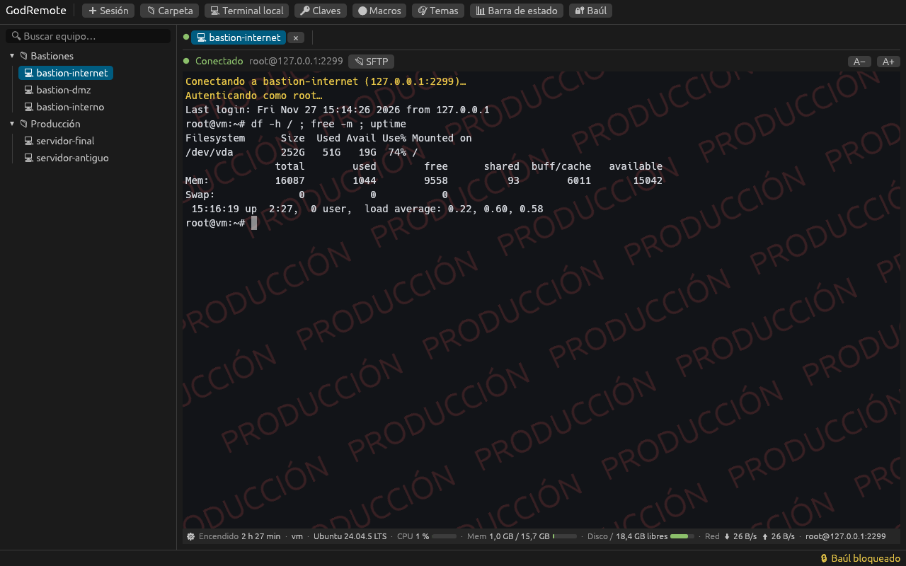
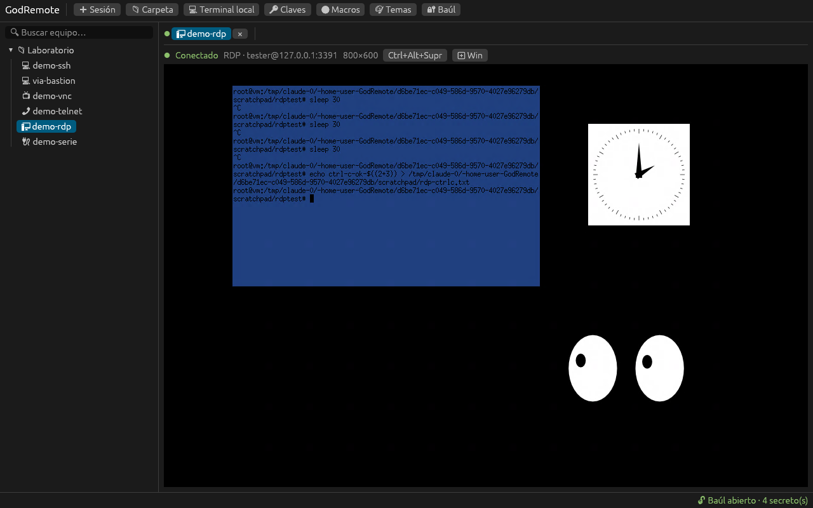

# GodRemote

Gestor de conexiones remotas escrito en Rust, al estilo de MobaXterm: un árbol
jerárquico de equipos, terminales con pestañas (SSH, Telnet, puerto serie),
explorador SFTP, escritorios remotos integrados (RDP y VNC), túneles, gestor de
claves, snippets con atajos, escritura simultánea en varios terminales, temas
personalizables y un baúl cifrado para las credenciales.








## Qué hace

| Área | Funcionalidad |
|------|---------------|
| **Equipos** | Árbol de carpetas y subcarpetas, búsqueda, mover, duplicar, renombrar y eliminar. Conexión rápida `usuario@host[:puerto]`. |
| **SSH** | Terminal integrado (xterm-256color, historial de 10 000 líneas, selección y copiar/pegar, ratón para `htop`, `mc`, `vim`…). Autenticación por contraseña, keyboard-interactive (PAM, códigos OTP), clave privada (OpenSSH, PEM, PuTTY `.ppk`) y agente SSH / Pageant. |
| **Saltos (bastiones)** | Cada equipo tiene su lista ordenada de saltos SSH, como `ProxyJump a,b,c`. Vale para SSH, SFTP, Telnet, VNC y RDP integrado. |
| **Túneles** | Reenvío local (`-L`), remoto (`-R`) y dinámico SOCKS5 (`-D`), por sesión. Se abren con el terminal y se cierran con él. |
| **X11** | Reenvío de aplicaciones gráficas al servidor X local, con cookie de autenticación sustituida. |
| **Verificación de host** | Usa `~/.ssh/known_hosts`, compartido con OpenSSH. Pregunta la primera vez y **rechaza** la conexión si la clave del servidor cambia. |
| **SFTP** | Dos paneles (local / remoto), subida y descarga recursivas con progreso y cancelación, crear carpeta, renombrar y eliminar. Se puede abrir sobre la conexión SSH de un terminal. Fechas en hora local. |
| **RDP** | Cliente integrado en una pestaña, o el cliente externo del sistema (FreeRDP / `mstsc`). |
| **VNC** | Cliente integrado (RFB 3.3–3.8; Raw, CopyRect, Hextile, ZRLE; contraseña VNC). |
| **Telnet y serie** | Terminales para Telnet y para puertos serie (`COM3`, `/dev/ttyUSB0`…). |
| **Snippets** | Textos y órdenes con nombre que se envían al terminal desde el menú o con un atajo de teclado propio (`Ctrl+Alt+D`, `F6`…). Se escriben a mano o se graban tecleando. |
| **Difusión** | Lo que escribes en un terminal se envía a la vez a todos los terminales abiertos o solo a los que elijas. |
| **Barra de información** | Bajo cada terminal SSH: nombre del servidor, sistema, tiempo encendido, CPU, memoria, disco, red… Se elige qué se muestra, en qué orden y cada cuánto se actualiza. |
| **Temas** | Cinco temas integrados y editor en vivo de colores, tamaños de letra, interlineados, separaciones y bordes. Importar y exportar en JSON. |
| **Fondo del terminal** | Un texto, un dibujo ASCII o una imagen detrás del texto, con la opacidad que se quiera. Por tema o por equipo. |
| **Claves** | Lista las claves de `~/.ssh` y las propias, genera pares Ed25519 / ECDSA (con passphrase opcional), importa claves y copia la pública. |
| **Credenciales** | Baúl cifrado con contraseña maestra (Argon2id + XChaCha20-Poly1305). Las contraseñas solo se guardan tras una autenticación correcta. |

## Compilar y ejecutar

Hace falta Rust 1.88 o posterior, un compilador de C, CMake y NASM (los usan
las librerías criptográficas).

```bash
cargo run --release
```

En Linux se necesitan además las librerías de escritorio habituales. En
Debian/Ubuntu:

```bash
sudo apt install build-essential cmake libxkbcommon-x11-0 libgl1 libegl1
```

### Ejecutable de Windows desde Linux

Con `mingw-w64` y `nasm` instalados:

```bash
rustup target add x86_64-pc-windows-gnu
```

```bash
cargo build --release --target x86_64-pc-windows-gnu
```

El resultado es un único `godremote.exe` que solo depende de DLL del sistema.

## Uso

- **➕ Sesión** crea un equipo; **📁 Carpeta** crea una carpeta dentro de la
  seleccionada.
- **Doble clic** sobre un equipo conecta. **Clic derecho** ofrece editar,
  duplicar, mover, eliminar y las formas alternativas de abrirlo.
- En el terminal: `Ctrl+C` copia si hay texto seleccionado y, si no, envía la
  interrupción; `Ctrl+V` pega; `Mayús+RePág/AvPág` o la rueda recorren el
  historial. Cuando una aplicación remota usa el ratón, `Mayús` devuelve el
  ratón a la selección local.
- En SFTP: doble clic entra en una carpeta o transfiere un fichero;
  `Ctrl+clic` selecciona varios.
- En un escritorio remoto: el teclado y el ratón van al equipo remoto mientras
  la pestaña tiene el foco. `Ctrl+V` envía antes el portapapeles local. Los
  botones **Ctrl+Alt+Supr** y **Win** envían esas teclas, que el sistema local
  no deja capturar.

### Túneles, salto y X11

En el editor de una sesión:

- **Saltos (bastiones SSH)**: añade, en orden, las sesiones SSH del árbol por
  las que hay que pasar. Se conecta a la primera, desde ella a la segunda, y
  así hasta el destino; el editor muestra el camino resultante. Si un salto
  necesita a su vez otros, se intercalan solos. Está disponible para SSH,
  SFTP, Telnet, VNC y RDP integrado (no con el cliente RDP externo).
- **X11**: necesita un servidor X local (el propio escritorio en Linux;
  VcXsrv, Xming o WSLg en Windows; XQuartz en macOS).
- **Túneles**: tipo, dirección y puerto de escucha, y destino. La cabecera del
  terminal muestra cuántos están activos.

### Barra de información del servidor

Bajo cada terminal SSH hay una barra con el estado del servidor. **📊 Barra de
estado** (o el engranaje de la propia barra) abre sus ajustes:

- **Qué se muestra y en qué orden**: nombre de la sesión, nombre del servidor,
  usuario y dirección, direcciones IP, sistema operativo, kernel, tiempo
  encendido, carga media, uso de CPU, memoria, intercambio, espacio libre en
  disco, tráfico de red, usuarios conectados, procesos y hora del servidor.
- **Discos**: las rutas cuyo espacio libre interesa (`/, /home, /var`).
- **Actualizar cada** tantos segundos, barritas de uso, y a partir de qué
  porcentaje un valor se pinta en color de aviso o de error.

Los datos se piden por un canal aparte de la misma conexión SSH: no se
escribe nada en tu terminal ni se abre otra conexión. Hace falta que el
servidor tenga una shell POSIX (`sh`); el uso de CPU, memoria y red sale de
`/proc`, así que en sistemas que no son Linux solo aparecen el nombre, el
sistema y el disco. En equipos donde no proceda (routers, conmutadores) se
desactiva en la ficha de la sesión, en «Terminal: barra de información y
fondo».

### Temas

**🎨 Temas** abre el gestor:

- Elige un tema de la lista y se aplica al instante.
- **Duplicar y editar** abre el editor, con todo agrupado por secciones. Los
  cambios se ven en vivo:
  - **Colores** de la interfaz y del terminal, incluidos los 16 ANSI.
  - **Letra e interlineado**: tamaño de la letra de la interfaz, títulos,
    texto pequeño, botones, terminal y barra de información; interlineado de
    la interfaz y del terminal, y separación entre las letras del terminal.
  - **Separaciones y forma**: separación horizontal y vertical entre
    elementos, relleno de los botones, alto mínimo de filas y botones,
    redondeo, grosor de bordes, márgenes de ventanas y menús, sangría del
    árbol, ancho de las barras de desplazamiento y margen del terminal.
  - **Fondo del terminal** (véase más abajo).
- **Descargar tema base** guarda un JSON legible para modificarlo con
  cualquier editor de texto; **Importar un tema** lo carga (también se puede
  soltar el fichero sobre la ventana).

Un tema es un JSON como este; los campos que falten se toman del tema base
(el fichero que da «Descargar tema base» los trae todos):

```json
{
  "nombre": "Mi tema",
  "oscuro": true,
  "interfaz": { "fondo": "#1b1b1b", "acento": "#d35400", "texto": "#c4c4c4" },
  "terminal": { "fondo": "#1a120b", "texto": "#ffd9a8", "ansi": { "rojo": "#cc6666" } },
  "letra": { "interfaz": 14, "terminal": 16, "interlineado_terminal": 1.2 },
  "forma": { "redondeo": 4, "espaciado": 8, "relleno_botones_vertical": 4 },
  "fondo_terminal": { "tipo": "texto", "texto": "PRODUCCIÓN", "color": "#ff5c5c",
                      "opacidad": 15, "giro": -25, "repetir": true }
}
```

### Fondo del terminal

En el editor de temas, **Fondo del terminal** permite poner detrás del texto:

- un **texto** (por ejemplo `PRODUCCIÓN`), con su tamaño, color y giro, una
  sola vez o repetido por todo el terminal como una marca de agua;
- un **dibujo ASCII**, escrito, pegado o cargado de un fichero de texto;
- una **imagen** (PNG, JPEG, GIF, BMP o WebP), a su tamaño, ajustada,
  rellenando, estirada o en mosaico.

En los tres casos se elige la **opacidad** (de 0 a 100 %) y la posición. La
imagen se guarda dentro del propio tema, así que al exportarlo viaja con él;
las muy grandes se reducen al cargarlas.

Cada equipo puede tener además **su propio fondo**, que sustituye al del
tema: en la ficha de la sesión, «Terminal: barra de información y fondo» →
«Fondo propio para este equipo». Sirve para distinguir de un vistazo los
servidores delicados.

### Snippets y atajos

Un snippet es un texto o una serie de órdenes con nombre que se envía al
terminal activo. **⚡ Snippets** los lista (con su atajo al lado) y permite:

- **Nuevo snippet…**: nombre, texto y atajo. Cada salto de línea es Intro; si
  el texto no acaba en salto de línea, queda escrito a la espera de que lo
  completes. `\e`, `\t` o `\x03` representan teclas especiales.
- **Grabar tecleando en el terminal activo**: lo que teclees hasta pulsar
  **Detener** se guarda como snippet.
- **Gestionar snippets y atajos…**: editar, lanzar y eliminar.

Para asignar un atajo, pulsa **Asignar…** y a continuación la combinación de
teclas. Vale cualquiera con Ctrl o Alt y las teclas de función (F1–F12),
solas o con Mayús; no valen una letra sola ni Ctrl+C, Ctrl+V y Ctrl+X, y dos
snippets no pueden compartir atajo. Los atajos actúan cuando el teclado está
en un terminal conectado, y tienen prioridad sobre lo que esa combinación
signifique en la shell (por eso convienen Ctrl+Alt+letra, Ctrl+Mayús+letra o
las teclas de función, que no chocan con nada).

### Escribir en varios terminales a la vez

El botón **📡 Difusión** de la cabecera de cada terminal abre sus opciones:

- **Escribir a la vez en varios terminales** la activa.
- **En todos los terminales abiertos**, o **solo en los que elija**,
  marcándolos en la lista.

Con la difusión activa, lo que teclees, pegues o lances con un snippet en un
terminal del grupo se envía también a los demás: escribes `hola` y aparece
en todos. Mientras escribes para varios, el terminal lleva un marco de color,
la cabecera dice en cuántos estás escribiendo y sus pestañas cambian de
color. Un terminal que no está en el grupo sigue funcionando por separado.
La difusión se desactiva sola al cerrar la aplicación.

## Dónde se guardan los datos

En el directorio de configuración del usuario (`~/.config/godremote` en
Linux, `%APPDATA%\godremote` en Windows; se puede cambiar con la variable
`GODREMOTE_HOME`):

| Fichero | Contenido |
|---------|-----------|
| `sessions.json` | Árbol de equipos. **No contiene secretos.** |
| `vault.json` | Contraseñas y passphrases, cifradas. |
| `keys/` | Claves generadas o importadas desde la aplicación. |
| `themes/` | Temas del usuario. |
| `settings.json` | Tema elegido y ajustes de la barra de información. |
| `macros.json` | Snippets y sus atajos. |
| `tls_known_hosts.json` | Huellas de los certificados RDP aceptados. |
| `rdp/` | Registros de la última ejecución del cliente RDP externo. |

Si se olvida la contraseña maestra, los secretos del baúl no se pueden
recuperar; el resto de la configuración sigue intacta.

## Seguridad

- **Telnet y VNC no cifran nada**: úsalos solo en redes de confianza o a
  través de un túnel SSH.
- Con el cliente RDP externo la contraseña se entrega por la entrada estándar
  (FreeRDP 2 y 3), nunca en la línea de órdenes.
- Los túneles dinámicos y locales escuchan en `127.0.0.1` salvo que se indique
  otra dirección.
- El reenvío X11 da a las aplicaciones remotas acceso a tu servidor X (pueden
  leer el teclado y la pantalla): actívalo solo con servidores de confianza.

## Limitaciones conocidas

- **RDP integrado**: probado solo contra el servidor «shadow» de FreeRDP, no
  contra Windows, xrdp ni GNOME Remote Desktop. Autenticación de red (NLA)
  con NTLM, sin Kerberos; sin RD Gateway, redirección de granjas ni tarjetas
  inteligentes; sin audio, discos, impresoras, varios monitores ni cambio de
  tamaño en caliente (para otro tamaño hay que reconectar). El portapapeles
  de texto y los caracteres no ASCII están implementados pero sin verificar
  contra un servidor real. Si algo falla, la misma sesión se puede abrir con
  el cliente externo (clic derecho → «Abrir con el cliente externo»).
- **Versión de la librería SSH**: el cliente RDP integrado obliga hoy a usar
  russh 0.65.1 en lugar de 0.65.4 (véase la nota de `Cargo.toml`), con lo que
  faltan varios endurecimientos frente a servidores maliciosos publicados en
  0.65.2–0.65.4. Se recupera con `cargo update -p russh` cuando las
  dependencias de IronRDP lo permitan.
- VNC: sin cifrado (VeNCrypt/TLS) ni las codificaciones Tight; el portapapeles
  solo admite texto Latin-1, como define el protocolo.
- Escritorios remotos: la tecla Windows y Ctrl+Alt+Supr solo desde los
  botones; Ctrl+Alt a la vez se trata como AltGr.
- X11: hace falta un servidor X local; GodRemote no trae uno propio.
- Los túneles van ligados al terminal de la sesión: no hay un gestor de
  túneles independiente.
- Barra de información: solo en terminales SSH (no en Telnet, serie ni en el
  terminal local) y pensada para servidores Linux; en Windows no da datos.
  Un servidor que limite a una las sesiones por conexión (`MaxSessions 1`)
  no deja abrir el canal que necesita.
- Fondo del terminal: de un GIF animado se usa solo el primer fotograma.
- Snippets: los atajos solo actúan con el teclado en un terminal (no en un
  escritorio remoto ni en SFTP).
- Difusión: se repite el teclado, lo pegado y los snippets, no el ratón. Cada
  terminal recibe las mismas teclas, pero lo que hagan depende de lo que
  tenga en pantalla: conviene que todos estén en el mismo punto.
- Saltos: como máximo ocho encadenados; cada salto se autentica con su
  propia sesión (no hay reenvío del agente SSH entre saltos).
- Sin Mosh, FTP ni editor de texto remoto.
- Solo se ha probado en Linux (X11). El ejecutable de Windows se compila
  desde Linux y no se ha podido ejecutar en el entorno de desarrollo.

## Pruebas

```bash
cargo test
```

- Pruebas unitarias del modelo, baúl, claves, terminal, temas, fondos,
  barra de información, snippets y atajos, difusión, Telnet, X11, túneles,
  VNC y RDP.
- `tests/auth_methods.rs`: contraseña y keyboard-interactive contra un
  servidor SSH en el propio proceso.
- `tests/ssh_integration.rs`: clave con passphrase, verificación de host,
  shell y SFTP contra un `sshd` real.
- `tests/ssh_features.rs`: uno y varios saltos encadenados (tres `sshd`
  reales), túneles `-L`/`-R`/`-D` y X11; Telnet contra un `telnetd` real,
  directo y a través de dos saltos.
- `tests/monitor_integration.rs`: barra de información contra un `sshd`
  real (datos coherentes con los del equipo, y la consulta deja de
  ejecutarse en el servidor al cerrarla).
- `tests/vnc_integration.rs`: cliente VNC contra `x11vnc`, directo y a
  través de un salto SSH.
- `tests/rdp_integration.rs`: cliente RDP integrado contra
  `freerdp-shadow-cli3` (NLA y solo TLS, confianza en el certificado,
  contraseñas, ratón y teclado; directo y a través de un salto SSH).

Las pruebas contra servidores reales se omiten solas si falta el programa
necesario (`sshd`, `telnetd`, `socat`, `Xvfb`, `x11vnc`…) o no se ejecutan
como root.

## Estructura

```
src/
  model.rs        árbol de carpetas y sesiones
  vault.rs        baúl cifrado
  keys.rs         claves SSH
  ssh.rs          conexión, saltos, autenticación y shell
  tunnels.rs      reenvío de puertos y SOCKS5
  x11.rs          reenvío X11
  sftp.rs         cliente SFTP y transferencias
  telnet.rs       cliente Telnet
  serial.rs       consola por puerto serie
  desktop.rs      interfaz común de los escritorios remotos
  vnc.rs          cliente VNC
  rdp_client.rs   cliente RDP integrado
  rdp.rs          lanzador del cliente RDP externo
  trust.rs        confianza en certificados TLS
  terminal.rs     emulador de terminal y shell local
  theme.rs        temas
  backdrop.rs     fondo del terminal (texto, ASCII, imagen)
  monitor.rs      consulta del estado del servidor
  macros.rs       snippets de terminal y sus atajos
  ui/             interfaz (egui)
```
