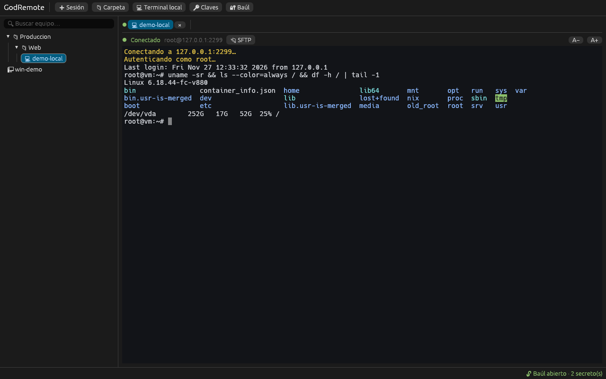
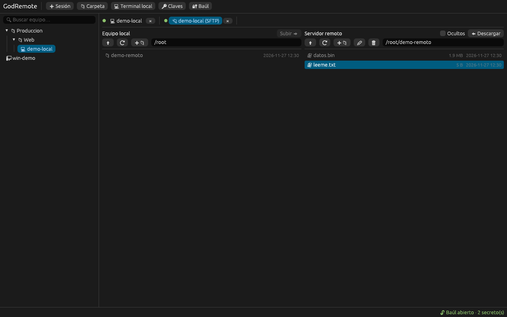

# GodRemote

Gestor de conexiones remotas escrito en Rust, al estilo de MobaXterm: un árbol
jerárquico de equipos, terminal SSH con pestañas, explorador SFTP, lanzador de
RDP, gestor de claves y un baúl cifrado para las credenciales.




## Qué hace

| Área | Funcionalidad |
|------|---------------|
| **Equipos** | Árbol de carpetas y subcarpetas, búsqueda, mover, duplicar, renombrar y eliminar. Conexión rápida `usuario@host[:puerto]`. |
| **SSH** | Terminal integrado (xterm-256color, historial de 10 000 líneas, selección y copiar/pegar, redimensionado). Autenticación por contraseña, keyboard-interactive (PAM, códigos OTP), clave privada (OpenSSH, PEM, PuTTY `.ppk`) y agente SSH / Pageant. |
| **Verificación de host** | Usa `~/.ssh/known_hosts`, compartido con OpenSSH. Pregunta la primera vez y **rechaza** la conexión si la clave del servidor cambia. |
| **SFTP** | Dos paneles (local / remoto), subida y descarga recursivas con progreso y cancelación, crear carpeta, renombrar y eliminar. Se puede abrir sobre la conexión SSH ya abierta de un terminal. |
| **RDP** | Lanza el cliente del sistema: FreeRDP en Linux/macOS, `mstsc` en Windows. |
| **Claves** | Lista las claves de `~/.ssh` y las propias, genera pares Ed25519 / ECDSA (con passphrase opcional), importa claves y copia la pública. |
| **Credenciales** | Baúl cifrado con contraseña maestra (Argon2id + XChaCha20-Poly1305). Las contraseñas solo se guardan tras una autenticación correcta. |
| **Terminal local** | Pestañas con la shell del propio equipo. |

## Compilar y ejecutar

Hace falta Rust 1.88 o posterior, un compilador de C y CMake (los usa la
librería criptográfica).

```bash
cargo run --release
```

En Linux se necesitan además las librerías de escritorio habituales. En
Debian/Ubuntu:

```bash
sudo apt install build-essential cmake libxkbcommon-x11-0 libgl1 libegl1
```

Para RDP en Linux o macOS instala FreeRDP (`freerdp3-x11` en Debian/Ubuntu,
`freerdp` en Fedora/Arch, `brew install freerdp` en macOS).

## Uso

- **➕ Sesión** crea un equipo; **📁 Carpeta** crea una carpeta dentro de la
  seleccionada.
- **Doble clic** sobre un equipo conecta. **Clic derecho** ofrece editar,
  duplicar, mover, eliminar y abrir SFTP.
- En el terminal: `Ctrl+C` copia si hay texto seleccionado y, si no, envía la
  interrupción; `Ctrl+V` pega; `Mayús+RePág/AvPág` o la rueda recorren el
  historial.
- En SFTP: doble clic entra en una carpeta o transfiere un fichero;
  `Ctrl+clic` selecciona varios.

## Dónde se guardan los datos

En el directorio de configuración del usuario (`~/.config/godremote` en
Linux; se puede cambiar con la variable `GODREMOTE_HOME`):

| Fichero | Contenido |
|---------|-----------|
| `sessions.json` | Árbol de equipos. **No contiene secretos.** |
| `vault.json` | Contraseñas y passphrases, cifradas. |
| `keys/` | Claves generadas o importadas desde la aplicación. |
| `rdp/` | Registros de la última ejecución de FreeRDP por sesión. |

Si se olvida la contraseña maestra, los secretos del baúl no se pueden
recuperar; el resto de la configuración sigue intacta.

## Limitaciones conocidas

- **RDP no está embebido**: se abre en la ventana del cliente externo. Con
  FreeRDP 3 la contraseña se pasa por la entrada estándar; con FreeRDP 2 va en
  la línea de órdenes y es visible para otros usuarios locales mientras dura la
  sesión. En Windows, `mstsc` pide y gestiona sus propias credenciales.
- Sin túneles SSH, reenvío X11, salto por bastión, Telnet/VNC/serie ni macros.
- Las fechas del explorador SFTP se muestran en UTC.
- El terminal no envía eventos de ratón a las aplicaciones remotas.
- Solo se ha probado en Linux (X11). El código contempla Windows y macOS, pero
  no se ha ejecutado en ellos.

## Pruebas

```bash
cargo test
```

- Pruebas unitarias del modelo, baúl, claves, terminal, SFTP y RDP.
- `tests/auth_methods.rs`: contraseña y keyboard-interactive contra un
  servidor SSH en el propio proceso.
- `tests/ssh_integration.rs`: clave con passphrase, verificación de host,
  shell y SFTP contra un `sshd` real de OpenSSH. Se omite si no hay `sshd`
  instalado o no se ejecuta como root.

## Estructura

```
src/
  model.rs      árbol de carpetas y sesiones
  vault.rs      baúl cifrado
  keys.rs       claves SSH
  ssh.rs        conexión, verificación de host, autenticación y shell
  sftp.rs       cliente SFTP y transferencias
  rdp.rs        lanzador de RDP
  terminal.rs   emulador de terminal y shell local
  ui/           interfaz (egui)
```
