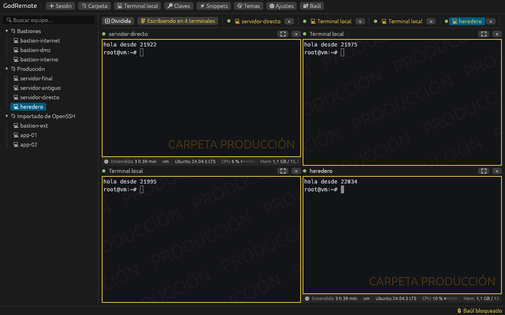
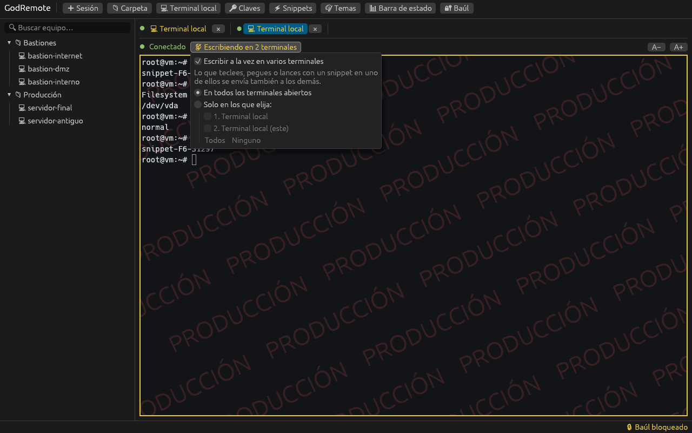
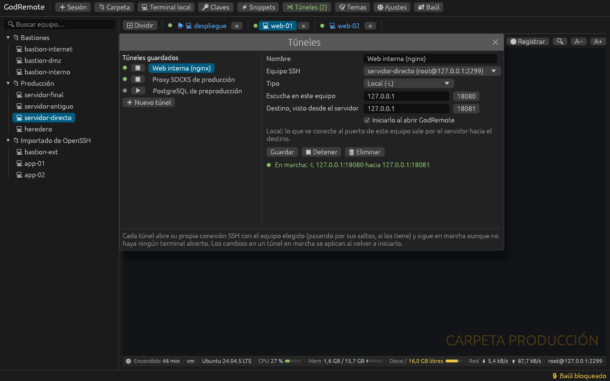
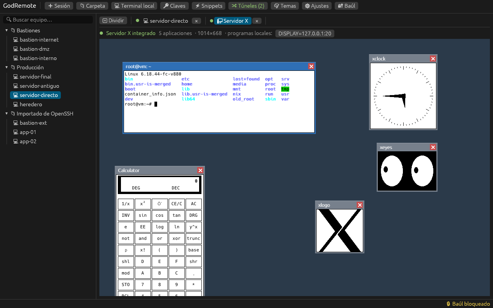
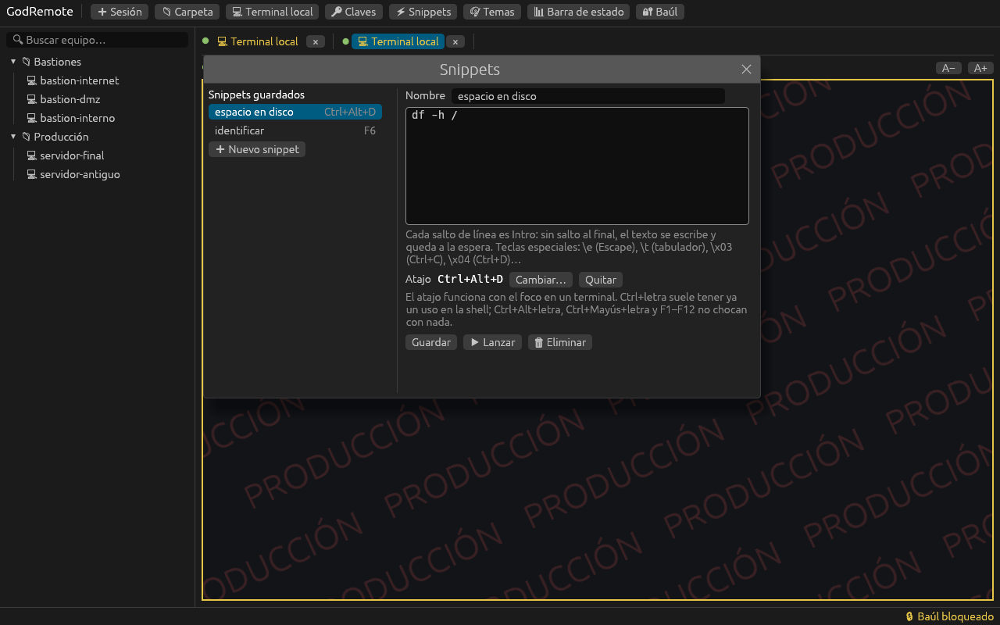

# GodRemote

Gestor de conexiones remotas escrito en Rust, al estilo de MobaXterm: un árbol
jerárquico de equipos, terminales con pestañas (SSH, Telnet, puerto serie),
explorador SFTP, escritorios remotos integrados (RDP y VNC), servidor X propio
para las aplicaciones gráficas remotas, túneles con su gestor, gestor de
claves, snippets con atajos, vista dividida y escritura simultánea en varios
terminales, ajustes heredados por carpeta, importación desde otras
herramientas, temas personalizables y un baúl cifrado para las credenciales.












## Qué hace

| Área | Funcionalidad |
|------|---------------|
| **Equipos** | Árbol de carpetas y subcarpetas, búsqueda, mover, duplicar, renombrar y eliminar. Conexión rápida `usuario@host[:puerto]`. |
| **Carpetas con valores** | Una carpeta puede dar a sus equipos el usuario, la autenticación, los saltos, el fondo del terminal y la barra de información. |
| **Importar y copiar** | Importa equipos de `~/.ssh/config`, PuTTY y MobaXterm. Copia de seguridad de toda la configuración en un solo fichero. |
| **SSH** | Terminal integrado (xterm-256color, historial de 10 000 líneas, selección y copiar/pegar, ratón para `htop`, `mc`, `vim`…). Autenticación por contraseña, keyboard-interactive (PAM, códigos OTP), clave privada (OpenSSH, PEM, PuTTY `.ppk`) y agente SSH / Pageant. |
| **Saltos (bastiones)** | Cada equipo tiene su lista ordenada de saltos SSH, como `ProxyJump a,b,c`. Vale para SSH, SFTP, Telnet, VNC y RDP integrado. |
| **Túneles** | Reenvío local (`-L`), remoto (`-R`) y dinámico SOCKS5 (`-D`). Ligados a una sesión (se abren y se cierran con su terminal) o guardados en el **gestor de túneles**, que los inicia y los detiene sin abrir un terminal. |
| **X11** | Servidor X propio, escrito en Rust e integrado: las aplicaciones gráficas remotas (clásicas, GTK 3, Qt 5, Tk, Motif, Java) se ven en una pestaña sin instalar VcXsrv, Xming ni XQuartz. También puede usarse el servidor X del sistema. Reenvío por SSH con cookie de autenticación. |
| **Agente y proxy** | Reenvío del agente SSH a un equipo (como `ssh -A`) y salida a través de un proxy HTTP o SOCKS5 de empresa. |
| **Verificación de host** | Usa `~/.ssh/known_hosts`, compartido con OpenSSH. Pregunta la primera vez y **rechaza** la conexión si la clave del servidor cambia. |
| **Terminal** | Búsqueda en pantalla e historial, registro de la sesión en un fichero, reconexión automática si se cae la red y reapertura de las pestañas al arrancar. Enlaces que se abren con `Ctrl+clic` y palabras resaltadas (errores en rojo, avisos en amarillo…) con reglas propias. |
| **Pestañas** | Se reordenan arrastrando, se renombran con doble clic, llevan el color de su carpeta (producción en rojo) y avisan cuando hay salida nueva (o suena la campana) en una que no estás mirando. |
| **Paleta de órdenes** | `Ctrl+Mayús+P` y escribir: salta a un equipo, una pestaña, un snippet, un túnel o una acción. Atajos para cambiar, abrir y cerrar pestañas. |
| **Protecciones** | Pregunta antes de pegar varias líneas y antes de cerrar pestañas (o la aplicación) con sesiones conectadas. |
| **Automatización** | Órdenes que se envían solas al conectar a un equipo, y ejecutar una orden en todos los equipos de una carpeta recogiendo la salida y el código de cada uno. |
| **Vista dividida** | Varios terminales a la vez en mosaico, combinable con la difusión. |
| **SFTP** | Dos paneles (local / remoto), subida y descarga recursivas con progreso y cancelación, crear carpeta, renombrar y eliminar. Arrastrar y soltar desde el sistema, permisos (`chmod`), reanudar transferencias a medias y sincronizar carpetas con un plan previo. Se puede abrir sobre la conexión SSH de un terminal, seguir su carpeta y editar ficheros remotos con el editor local. Fechas en hora local. |
| **RDP** | Cliente integrado en una pestaña, o el cliente externo del sistema (FreeRDP / `mstsc`). |
| **VNC** | Cliente integrado (RFB 3.3–3.8; Raw, CopyRect, Hextile, ZRLE; contraseña VNC). |
| **Telnet y serie** | Terminales para Telnet y para puertos serie (`COM3`, `/dev/ttyUSB0`…). |
| **Snippets** | Textos y órdenes con nombre que se envían al terminal desde el menú o con un atajo de teclado propio (`Ctrl+Alt+D`, `F6`…). Se escriben a mano o se graban tecleando, y admiten variables (`{{host}}`, `{{?Pregunta}}`). |
| **Difusión** | Lo que escribes en un terminal se envía a la vez a todos los terminales abiertos o solo a los que elijas. |
| **Barra de información** | Bajo cada terminal SSH: nombre del servidor, sistema, tiempo encendido, CPU, memoria, disco, red… Se elige qué se muestra, en qué orden y cada cuánto se actualiza. |
| **Temas** | Cinco temas integrados y editor en vivo de colores, tipos y tamaños de letra, interlineados, separaciones y bordes. Importar y exportar en JSON. |
| **Fondo del terminal** | Un texto, un dibujo ASCII o una imagen detrás del texto, con la opacidad que se quiera. Por tema o por equipo. |
| **Claves** | Lista las claves de `~/.ssh` y las propias, genera pares Ed25519 / ECDSA (con passphrase opcional), importa claves y copia la pública. |
| **Credenciales** | Baúl cifrado con contraseña maestra (Argon2id + XChaCha20-Poly1305). Las contraseñas solo se guardan tras una autenticación correcta. Se bloquea solo tras un rato sin actividad y tiene un visor para revisar y borrar lo guardado. |
| **Terminal local** | Con la shell que elijas: PowerShell, cmd, WSL o Git Bash en Windows; bash, zsh, fish… en Linux y macOS. |

## Compilar y ejecutar

Hace falta Rust 1.88 o posterior, un compilador de C, CMake y NASM (los usan
las librerías criptográficas).

```bash
cargo run --release
```

En Linux se necesitan además las librerías de escritorio habituales. En
Debian/Ubuntu:

```bash
sudo apt install build-essential cmake libxkbcommon-x11-0 libgl1 libegl1
```

### Compilación y pruebas automáticas

Cada cambio que se sube pasa por GitHub Actions (`.github/workflows/ci.yml`):

- **Linux**: formato, todas las pruebas de las dos ediciones —incluidas las
  que necesitan servidores reales (`sshd`, `telnetd`, `x11vnc`, FreeRDP,
  clientes X)— y `clippy` sin avisos.
- **Windows y macOS**: compilación nativa y las pruebas que no dependen de
  servidores de Unix.

Al empujar una etiqueta `vX.Y.Z` se compilan además los ejecutables nativos
de las dos ediciones para Windows, Linux y macOS, y se publican como
**Release** en GitHub (si existe `docs/versiones/vX.Y.Z.md`, encabeza sus
notas). Los mismos ejecutables se pueden pedir sin publicar
una versión —se descargan como artefactos de la ejecución, en la pestaña
*Actions*—: a mano desde esa pestaña, o poniendo `[ejecutables]` en el
mensaje de un commit.

### Ejecutable de Windows desde Linux

Con `mingw-w64` y `nasm` instalados:

```bash
rustup target add x86_64-pc-windows-gnu
```

```bash
cargo build --release --target x86_64-pc-windows-gnu
```

El resultado es un único `godremote.exe` que solo depende de DLL del sistema.

### Dos ediciones: completa y «SSH reforzada»

El cliente RDP integrado depende de IronRDP, cuyas dependencias fijan una
versión preliminar de `rsa` que impide a Cargo elegir la última versión de
la librería SSH (russh). Eso se decide al compilar, así que hay dos
ediciones del mismo código:

| Edición | RDP integrado | Librería SSH | Cómo se compila |
|---------|---------------|--------------|-----------------|
| **Completa** (`godremote`) | Sí | russh 0.65.1 | `cargo build --release` |
| **SSH reforzada** (`godremote-reforzado`) | No (RDP con el cliente externo) | russh 0.65.4 | `cargo build --release --manifest-path reforzado/Cargo.toml --target-dir target` |

Para Windows, ya compiladas (versión 0.7.0): `dist/GodRemote-windows-x64.zip`
(completa) y `dist/GodRemote-ssh-reforzado-windows-x64.zip` (SSH reforzada).
Las de Linux y macOS —y las de cada versión publicada— salen de GitHub
Actions, como se explica arriba. Las dos ediciones usan la misma carpeta de
configuración, así que se puede pasar de una a otra.

A la 0.65.1 le faltan varios endurecimientos frente a servidores SSH
maliciosos publicados entre la 0.65.2 y la 0.65.4. Si no usas el RDP
integrado, o te conectas a servidores en los que no confías del todo, usa la
edición reforzada. **⚙ Ajustes** dice qué edición y qué versión de la
librería estás usando; en la completa, además, permite desactivar el RDP
integrado para que RDP se abra siempre con el cliente externo (eso cambia el
cliente, no la librería).

`reforzado/` tiene su propio `Cargo.toml` y `Cargo.lock` porque un
`Cargo.lock` incluye también las dependencias opcionales; una prueba
comprueba que las dos listas de dependencias no se separan. Cuando IronRDP
deje de fijar esa versión bastará `cargo update -p russh` y sobrará la
segunda edición.

## Uso

- **➕ Sesión** crea un equipo; **📁 Carpeta** crea una carpeta dentro de la
  seleccionada.
- **Doble clic** sobre un equipo conecta. **Clic derecho** ofrece editar,
  duplicar, mover, eliminar y las formas alternativas de abrirlo.
- En el terminal: `Ctrl+C` copia si hay texto seleccionado y, si no, envía la
  interrupción; `Ctrl+V` pega; `Mayús+RePág/AvPág` o la rueda recorren el
  historial. Cuando una aplicación remota usa el ratón, `Mayús` devuelve el
  ratón a la selección local.
- En las pestañas: **arrastra** una para cambiarla de sitio, **doble clic**
  para renombrarla (Intro guarda, Escape cancela), clic central para
  cerrarla y **clic derecho** para duplicarla, llevarla al principio o al
  final y cerrar las demás o las de su derecha. El nombre que le pongas se
  conserva al reabrir las pestañas.
- En SFTP: doble clic entra en una carpeta o transfiere un fichero;
  `Ctrl+clic` selecciona varios.
- En un escritorio remoto: el teclado y el ratón van al equipo remoto mientras
  la pestaña tiene el foco. `Ctrl+V` envía antes el portapapeles local. Los
  botones **Ctrl+Alt+Supr** y **Win** envían esas teclas, que el sistema local
  no deja capturar.

### Paleta de órdenes y atajos

**Ctrl+Mayús+P** abre una caja de búsqueda sobre todo lo que se puede abrir:
pestañas abiertas, equipos del árbol (por nombre, carpeta, usuario o
dirección), snippets, túneles y acciones (terminal local, vista dividida,
difusión, ajustes…). Se escribe parte del nombre —varias palabras, sin
acentos, o sus iniciales salteadas: «prd» encuentra «producción»—, se elige
con las flechas e Intro lo abre.

| Atajo | Hace |
|-------|------|
| `Ctrl+Mayús+P` | Paleta de órdenes |
| `Ctrl+Tab` · `Ctrl+AvPág` | Pestaña siguiente |
| `Ctrl+Mayús+Tab` · `Ctrl+RePág` | Pestaña anterior |
| `Ctrl+Mayús+T` | Terminal local nuevo |
| `Ctrl+Mayús+W` | Cerrar la pestaña |
| `Ctrl+Mayús+F` | Buscar en el terminal |

Todos llevan Mayús o una tecla que la shell no usa con Ctrl: `Ctrl+W`,
`Ctrl+T` y las demás combinaciones de la shell siguen llegando al terminal.
Se pueden desactivar en **⚙ Ajustes**, y un snippet no puede usar ninguno.

### Protecciones

- **Pegar varias líneas**: antes de enviarlas, el terminal enseña lo que hay
  en el portapapeles y pregunta (Intro pega, Esc cancela). En una shell cada
  línea se ejecuta según llega, así que un pegado equivocado puede ser caro.
- **Cerrar con sesiones vivas**: al cerrar una pestaña conectada —o varias
  de golpe, o la propia aplicación con sesiones o túneles en marcha— se
  pregunta antes. El foco va a «Cancelar»: una tecla de más no cierra nada.
- **Color por carpeta**: en la ficha de una carpeta (o de un equipo) se
  elige un color; sus pestañas lo llevan debajo del título y en una franja
  sobre el terminal. Rojo para producción, por ejemplo.

Las dos preguntas se pueden quitar en **⚙ Ajustes**.

### Órdenes al conectar y ejecutar en varios equipos

- **Órdenes al conectar**: en la ficha de un equipo SSH (Avanzado) se
  escriben las órdenes que deben teclearse solas en cuanto la shell termina
  de saludar, también al reconectar. Admiten las variables de los snippets
  (`{{host}}`, `{{usuario}}`, `{{nombre}}`, `{{fecha}}`…).
- **Ejecutar en varios equipos**: clic derecho sobre una carpeta →
  **Ejecutar una orden en sus equipos…** (o desde la paleta). Se eligen los
  equipos SSH, se escribe la orden (o se parte de un snippet) y GodRemote la
  lanza en todos, unos pocos a la vez, mostrando de cada uno su salida, su
  código y lo que tardó. Se puede cancelar, copiar la salida de uno o de
  todos y guardarla en un fichero. Con más de un equipo se pide una
  confirmación más.

### Carpetas que dan valores a sus equipos

Clic derecho sobre una carpeta → **Editar carpeta…** permite definir, para
los equipos que contiene (y los de sus subcarpetas):

- el **usuario** y el **fondo del terminal**, que se aplican a los equipos
  que no tengan el suyo;
- la **autenticación** (con su contraseña o passphrase en el baúl) y los
  **saltos**, que usan los equipos que marcan «la de la carpeta» en su ficha
  (los equipos nuevos lo marcan solos);
- desactivar la **barra de información** en todos ellos;
- el **color** con el que se marcan sus pestañas.

La ficha de cada equipo indica qué hereda y de qué carpeta. Si una
subcarpeta define un valor, manda sobre el de la carpeta de arriba.

### Túneles, salto y X11

En el editor de una sesión:

- **Saltos (bastiones SSH)**: añade, en orden, las sesiones SSH del árbol por
  las que hay que pasar. Se conecta a la primera, desde ella a la segunda, y
  así hasta el destino; el editor muestra el camino resultante. Si un salto
  necesita a su vez otros, se intercalan solos. Está disponible para SSH,
  SFTP, Telnet, VNC y RDP integrado (no con el cliente RDP externo).
- **X11**: marca «Reenviar aplicaciones gráficas (X11)» para que las
  aplicaciones gráficas que lances en ese equipo se vean aquí, en el servidor
  X integrado o en el del sistema (véase «Servidor X integrado»).
- **Túneles**: tipo, dirección y puerto de escucha, y destino. La cabecera del
  terminal muestra cuántos están activos. Estos túneles viven mientras viva
  el terminal de la sesión.
- **Reenviar el agente SSH**: como `ssh -A`. Las claves de tu agente
  (OpenSSH en Linux, macOS y Windows) quedan disponibles en ese equipo para
  saltar desde él a otros con `ssh` o `git`, sin copiar ninguna clave.

### Proxy de salida

Si la red no deja salir directamente, **⚙ Ajustes → Proxy de salida** hace
que la primera conexión hacia cada equipo pase por un proxy **HTTP**
(`CONNECT`) o **SOCKS5**, con usuario y contraseña si los pide (la
contraseña se guarda en el baúl). Vale para SSH, SFTP, Telnet, VNC y RDP
integrado, para el primer salto de una cadena y para los túneles del gestor.

- Las direcciones de este mismo equipo (`localhost`, `127.0.0.1`) nunca
  pasan por el proxy.
- **Sin proxy para** admite excepciones separadas por comas: un nombre, un
  final de dominio (`.interno`) o un comienzo de dirección (`10.`).
- Cada equipo puede pedir conexión directa en su ficha (Avanzado).
- El nombre del equipo lo resuelve el proxy, no este equipo.

### Servidor X integrado

GodRemote trae su propio servidor X, escrito en Rust: no hay que instalar
ni arrancar nada aparte. En **⚙ Ajustes → Aplicaciones gráficas (X11)** se
elige entre el **servidor X integrado** (por defecto en Windows) y el **del
sistema** (por defecto en Linux y macOS: el escritorio, VcXsrv, Xming,
XQuartz…).

Con el integrado:

- Conecta a un equipo SSH que tenga marcado el reenvío X11 y lanza una
  aplicación gráfica desde su terminal (`xterm &`, `xclock &`…). El servidor
  arranca con la primera aplicación y se abre la pestaña **Servidor X**, con
  todas las ventanas dentro.
- Cada ventana lleva su barra de título: se mueve arrastrándola, se
  redimensiona por cualquier borde o esquina, se **maximiza** con su botón o
  con doble clic en la barra (y se restaura igual), se trae al frente con un
  clic y se cierra con su aspa. Los diálogos salen centrados sobre su
  ventana. El teclado va a la ventana que tiene el foco; el ratón, a la que
  está debajo.
- La pantalla se ajusta sola al tamaño de la pestaña, y las ventanas
  maximizadas la siguen.
- El portapapeles va en los dos sentidos: lo que selecciones en una
  aplicación llega al portapapeles local, y el portapapeles local se
  entrega a las aplicaciones al entrar en la pestaña. Dentro se pega como
  en X: con el botón central o, en `xterm`, con `Mayús+Insert`.
- Cerrar la pestaña **para el servidor** y cierra las aplicaciones que
  tuviera; vuelve a arrancar solo con la siguiente.
- **Aceptar también programas de este equipo** hace que escuche en
  `127.0.0.1`; la pestaña muestra el `DISPLAY` que hay que usar (por ejemplo,
  desde WSL o desde un terminal local).

El servidor entiende el protocolo X11 básico (*core*: ventanas, dibujo,
fuentes, colores, teclado, ratón y selecciones) y las extensiones que piden
las aplicaciones actuales: **RENDER** (composición con transparencia y texto
suavizado: la usan GTK, Xft y Java), **SHAPE** (ventanas con forma) y
**RANDR** (para que sepan el tamaño de la pantalla y cuándo cambia).

| Aplicaciones | Estado |
|--------------|--------|
| Clásicas (`xterm` —también con `-fa`—, `xclock`, `xcalc`, `xeyes`, `xlogo`, `xmessage`, `xfontsel`, `xev`) y utilidades (`xdpyinfo`, `xprop`, `xwininfo`, `xlsfonts`, `xrandr`, `wmctrl`) | Probadas |
| **GTK 3** | Probada: teclado (con Ñ y €), ratón, menús, portapapeles en los dos sentidos |
| **Qt 5** | Probada: teclado, ratón y portapapeles |
| **Tk**, **Motif** | Probadas: botones, menús, diálogos y tecleo |
| **Java (Swing)** | Probada: botones y tecleo; el texto sale sin suavizar |
| **GTK 4** | No arranca (exige XInput2 y XKB) |
| Qt 6, navegadores (Chromium, Electron, Firefox), LibreOffice | Sin probar |
| Lo que necesite OpenGL (GLX) | No funciona |

Para lo que no funcione aquí sigue estando el servidor X del sistema.

Las aplicaciones remotas no son de fiar, y el servidor está hecho contando
con ello: una petición mal formada no puede tumbar GodRemote (como mucho se
expulsa a la aplicación que la envía) y la memoria que puede hacerle
reservar está acotada.

### Gestor de túneles

**🔀 Túneles**, en la barra superior, guarda túneles que no dependen de
ningún terminal. Cada uno tiene un nombre, el equipo SSH del árbol por el que
pasa (con sus saltos y su autenticación, heredada o propia), el tipo (`-L`,
`-R` o `-D`), dónde escucha y a dónde lleva.

- **▶ Iniciar** abre una conexión SSH solo para ese túnel; **⏹ Detener** la
  cierra. El botón de la barra muestra cuántos hay en marcha, en verde, o en
  rojo si alguno ha fallado.
- **Iniciarlo al abrir GodRemote** lo arranca solo (después de desbloquear el
  baúl, para no pedir contraseñas que ya están guardadas).
- Si la conexión se cae, el túnel se vuelve a levantar solo con las mismas
  esperas y el mismo límite de intentos que los terminales (**⚙ Ajustes**).
- Los túneles se guardan en `tunnels.json` y entran en la copia de seguridad.

### Barra de información del servidor

Bajo cada terminal SSH hay una barra con el estado del servidor. **📊 Barra de
estado** (o el engranaje de la propia barra) abre sus ajustes:

- **Qué se muestra y en qué orden**: nombre de la sesión, nombre del servidor,
  usuario y dirección, direcciones IP, sistema operativo, kernel, tiempo
  encendido, carga media, uso de CPU, memoria, intercambio, espacio libre en
  disco, tráfico de red, usuarios conectados, procesos y hora del servidor.
- **Discos**: las rutas cuyo espacio libre interesa (`/, /home, /var`).
- **Actualizar cada** tantos segundos, barritas de uso, y a partir de qué
  porcentaje un valor se pinta en color de aviso o de error.

Los datos se piden por un canal aparte de la misma conexión SSH: no se
escribe nada en tu terminal ni se abre otra conexión. Hace falta que el
servidor tenga una shell POSIX (`sh`); el uso de CPU, memoria y red sale de
`/proc`, así que en sistemas que no son Linux solo aparecen el nombre, el
sistema y el disco. En equipos donde no proceda (routers, conmutadores) se
desactiva en la ficha de la sesión, en «Terminal: barra de información y
fondo».

### Temas

**🎨 Temas** abre el gestor:

- Elige un tema de la lista y se aplica al instante.
- **Duplicar y editar** abre el editor, con todo agrupado por secciones. Los
  cambios se ven en vivo:
  - **Colores** de la interfaz y del terminal, incluidos los 16 ANSI.
  - **Letra e interlineado**: tamaño de la letra de la interfaz, títulos,
    texto pequeño, botones, terminal y barra de información; interlineado de
    la interfaz y del terminal, y separación entre las letras del terminal.
  - **Separaciones y forma**: separación horizontal y vertical entre
    elementos, relleno de los botones, alto mínimo de filas y botones,
    redondeo, grosor de bordes, márgenes de ventanas y menús, sangría del
    árbol, ancho de las barras de desplazamiento y margen del terminal.
  - **Fondo del terminal** (véase más abajo).
- **Descargar tema base** guarda un JSON legible para modificarlo con
  cualquier editor de texto; **Importar un tema** lo carga (también se puede
  soltar el fichero sobre la ventana).

Un tema es un JSON como este; los campos que falten se toman del tema base
(el fichero que da «Descargar tema base» los trae todos):

```json
{
  "nombre": "Mi tema",
  "oscuro": true,
  "interfaz": { "fondo": "#1b1b1b", "acento": "#d35400", "texto": "#c4c4c4" },
  "terminal": { "fondo": "#1a120b", "texto": "#ffd9a8", "ansi": { "rojo": "#cc6666" } },
  "letra": { "interfaz": 14, "terminal": 16, "interlineado_terminal": 1.2 },
  "forma": { "redondeo": 4, "espaciado": 8, "relleno_botones_vertical": 4 },
  "fondo_terminal": { "tipo": "texto", "texto": "PRODUCCIÓN", "color": "#ff5c5c",
                      "opacidad": 15, "giro": -25, "repetir": true }
}
```

### Fondo del terminal

En el editor de temas, **Fondo del terminal** permite poner detrás del texto:

- un **texto** (por ejemplo `PRODUCCIÓN`), con su tamaño, color y giro, una
  sola vez o repetido por todo el terminal como una marca de agua;
- un **dibujo ASCII**, escrito, pegado o cargado de un fichero de texto;
- una **imagen** (PNG, JPEG, GIF, BMP o WebP), a su tamaño, ajustada,
  rellenando, estirada o en mosaico.

En los tres casos se elige la **opacidad** (de 0 a 100 %) y la posición. La
imagen se guarda dentro del propio tema, así que al exportarlo viaja con él;
las muy grandes se reducen al cargarlas.

Cada equipo puede tener además **su propio fondo**, que sustituye al del
tema: en la ficha de la sesión, «Terminal: barra de información y fondo» →
«Fondo propio para este equipo». Sirve para distinguir de un vistazo los
servidores delicados.

### Vista dividida

**⊞ Dividir**, a la izquierda de las pestañas, reparte los terminales en
mosaico: todos los abiertos o solo los que elijas, con las columnas que
quieras. Un clic en un terminal le da el teclado (se marca con un marco);
doble clic en su título, o su botón de ampliar, lo deja a pantalla completa.
Con la vista dividida activa, el botón **📡 Difusión** pasa a la barra de
pestañas: es la forma cómoda de escribir en varios servidores viendo lo que
responde cada uno.

### Buscar, registrar y reconectar

- **Buscar** (`Ctrl+Mayús+F` o el botón 🔍): busca en la pantalla y en todo
  el historial, resalta las coincidencias y salta entre ellas con Intro y
  Mayús+Intro.
- **⏺ Registrar** guarda en un fichero de texto lo que vaya mostrando el
  terminal, sin colores ni secuencias de escape. En **⚙ Ajustes** se puede
  pedir que se registre siempre, con la hora en cada línea, y elegir la
  carpeta.
- **Reconexión**: si un terminal pierde la conexión, se vuelve a conectar
  solo, con esperas crecientes, conservando lo que había en pantalla. No se
  reintenta si lo que falla es la contraseña o la clave, ni si cierras tú la
  sesión. Se ajusta (o se desactiva) en **⚙ Ajustes**, donde también se
  puede pedir que al arrancar se reabran las pestañas de la última vez.

### Enlaces, palabras resaltadas y avisos de actividad

- **Enlaces**: las direcciones `http://`, `https://`, `ftp://` y `www.…` que
  aparezcan en el terminal se subrayan al pasar el ratón y se abren en el
  navegador con **Ctrl+clic**, o con el botón derecho (**Abrir enlace** /
  **Copiar enlace**). Un enlace partido en dos filas se reconoce entero.
- **Palabras resaltadas**: `error`, `failed`, `denied`… salen en rojo;
  `warning`, `timeout`… en amarillo; `ok`, `success`, `done`… en verde. En
  **⚙ Ajustes** se cambian las listas, se añaden reglas con su color (uno
  de la paleta del tema o uno propio) o se apaga todo. Solo cuentan las
  palabras enteras, sin distinguir mayúsculas, y lo que el servidor ya haya
  coloreado se deja como está.
- **Actividad**: una pestaña de terminal que recibe salida mientras miras
  otra se destaca; si además ha sonado la campana, lleva un 🔔. Se quita al
  abrirla, y se puede desactivar en **⚙ Ajustes**.

### Baúl de credenciales

**🔐 Baúl** guarda contraseñas y passphrases cifradas con una contraseña
maestra. Además de crear, desbloquear, bloquear y cambiar la contraseña:

- **Ver lo guardado…** lista cada secreto con su dueño (el equipo o la
  carpeta) y permite borrarlo. Para ver o copiar un valor hay que repetir la
  contraseña maestra. Los secretos de equipos que ya no existen se marcan y
  se pueden borrar de una vez.
- **Bloqueo automático**: tras 15 minutos sin teclado ni ratón en GodRemote
  el baúl se bloquea solo. El tiempo se cambia (o se desactiva) en
  **⚙ Ajustes**.

### Terminal local

**💻 Terminal local** abre la shell elegida en **⚙ Ajustes → Terminal
local** (por defecto, la del sistema). La flecha de al lado ofrece las demás
shells encontradas en el equipo —PowerShell, cmd, WSL y Git Bash en Windows;
bash, zsh, fish… en Linux y macOS— para abrir una en una sola pestaña. En
los ajustes también se puede escribir cualquier orden, por ejemplo
`wsl.exe -d Ubuntu`.

### SFTP: soltar, permisos, reanudar y sincronizar

- **Arrastrar y soltar**: suelta ficheros o carpetas del explorador del
  sistema sobre la pestaña SFTP y se suben a la carpeta remota que estás
  viendo, con el progreso y la cancelación de siempre.
- **Permisos**: la lista remota muestra los permisos (`rwxr-xr-x`). Clic
  derecho → **Permisos…** abre las nueve casillas y el valor en octal o en
  texto; en una carpeta se puede aplicar también a todo su contenido.
- **Si el destino ya existe**, se pregunta fichero a fichero (también dentro
  de las carpetas): **Reanudar** continúa desde donde se quedó cuando el
  destino es más pequeño que el origen, **Sustituir** u **Omitir**, con la
  opción de aplicarlo a todos.
- **Sincronizar…** compara la carpeta local con la remota (con sus
  subcarpetas, por tamaño y fecha) y enseña el **plan** antes de tocar nada:
  qué se sube, qué se descarga, qué está igual y qué existe solo en un lado.
  Hay tres modos —local → remoto, remoto → local y en los dos sentidos— y
  una casilla aparte, desmarcada, para **borrar** del destino lo que sobra
  (solo en los modos de un sentido, con el número de ficheros a la vista).
  Las copias conservan la fecha, de modo que una segunda pasada no encuentra
  nada que hacer.

### SFTP: editar y seguir al terminal

- **📝** abre el fichero remoto seleccionado con el editor de tu equipo (el
  asociado en el sistema, o el que indiques en **⚙ Ajustes**, por ejemplo
  `code -w` o `notepad`). Cada vez que lo guardes se sube solo; el panel
  muestra los ficheros en edición y cuándo se subieron.
- Un panel SFTP abierto desde un terminal (**📂 SFTP**) puede **seguir al
  terminal**: va a la carpeta en la que esté la shell. Necesita que la shell
  la anuncie en el título de la ventana (lo hace el `bash` de Debian, Ubuntu
  o Fedora tal como viene) o con la secuencia OSC 7.

### Importar equipos y copia de seguridad

**⚙ Ajustes → Importar equipos o hacer una copia…**:

- **OpenSSH**: un equipo por cada `Host` de `~/.ssh/config`, con su
  `HostName`, `User`, `Port`, `IdentityFile` y `ProxyJump` (como saltos).
- **PuTTY**: el fichero `.reg` que da
  `reg export HKCU\Software\SimonTatham\PuTTY\Sessions putty.reg`; en
  Windows, también directamente las sesiones guardadas en el equipo.
- **MobaXterm**: el fichero de «Export all sessions to file» o
  `MobaXterm.ini`; se importan SSH, SFTP, Telnet, RDP y VNC, con sus
  carpetas.

Lo importado queda en una carpeta nueva del árbol. Las contraseñas no se
importan.

La **copia de seguridad** guarda en un solo fichero los equipos, el baúl
(cifrado, tal cual), los ajustes, los snippets, los temas y, si se quiere,
las claves de la carpeta de GodRemote. Al restaurarla se guarda antes la
configuración actual, por si hay que volver atrás.

### Snippets y atajos

Un snippet es un texto o una serie de órdenes con nombre que se envía al
terminal activo. **⚡ Snippets** los lista (con su atajo al lado) y permite:

- **Nuevo snippet…**: nombre, texto y atajo. Cada salto de línea es Intro; si
  el texto no acaba en salto de línea, queda escrito a la espera de que lo
  completes. `\e`, `\t` o `\x03` representan teclas especiales.
- **Grabar tecleando en el terminal activo**: lo que teclees hasta pulsar
  **Detener** se guarda como snippet.
- **Gestionar snippets y atajos…**: editar, lanzar y eliminar.

Para asignar un atajo, pulsa **Asignar…** y a continuación la combinación de
teclas. Vale cualquiera con Ctrl o Alt y las teclas de función (F1–F12),
solas o con Mayús; no valen una letra sola ni Ctrl+C, Ctrl+V y Ctrl+X, y dos
snippets no pueden compartir atajo. Los atajos actúan cuando el teclado está
en un terminal conectado, y tienen prioridad sobre lo que esa combinación
signifique en la shell (por eso convienen Ctrl+Alt+letra, Ctrl+Mayús+letra o
las teclas de función, que no chocan con nada).

En el texto se pueden usar **variables**, que se sustituyen al lanzarlo:
`{{host}}`, `{{usuario}}`, `{{puerto}}`, `{{nombre}}`, `{{fecha}}` y
`{{hora}}`. Con `{{?Servicio}}` o `{{?Servicio=nginx}}` se pide un dato (con
su valor por defecto) antes de enviarlo. Con la difusión activa, cada
terminal recibe el snippet con sus propios datos. Lo que vaya entre llaves
dobles y no sea una variable (`docker ps --format '{{.Names}}'`) se deja
como está.

### Escribir en varios terminales a la vez

El botón **📡 Difusión** de la cabecera de cada terminal abre sus opciones:

- **Escribir a la vez en varios terminales** la activa.
- **En todos los terminales abiertos**, o **solo en los que elija**,
  marcándolos en la lista.

Con la difusión activa, lo que teclees, pegues o lances con un snippet en un
terminal del grupo se envía también a los demás: escribes `hola` y aparece
en todos. Mientras escribes para varios, el terminal lleva un marco de color,
la cabecera dice en cuántos estás escribiendo y sus pestañas cambian de
color. Un terminal que no está en el grupo sigue funcionando por separado.
La difusión se desactiva sola al cerrar la aplicación.

## Dónde se guardan los datos

En el directorio de configuración del usuario (`~/.config/godremote` en
Linux, `%APPDATA%\godremote` en Windows; se puede cambiar con la variable
`GODREMOTE_HOME`):

| Fichero | Contenido |
|---------|-----------|
| `sessions.json` | Árbol de equipos. **No contiene secretos.** |
| `vault.json` | Contraseñas y passphrases, cifradas. |
| `keys/` | Claves generadas o importadas desde la aplicación. |
| `themes/` | Temas del usuario. |
| `settings.json` | Tema elegido y demás ajustes. |
| `state.json` | Pestañas abiertas al cerrar (para reabrirlas). |
| `logs/` | Registros de las sesiones de terminal. |
| `edit/` | Copias temporales de los ficheros remotos en edición. |
| `macros.json` | Snippets y sus atajos. |
| `tunnels.json` | Túneles del gestor de túneles. |
| `tls_known_hosts.json` | Huellas de los certificados RDP aceptados. |
| `rdp/` | Registros de la última ejecución del cliente RDP externo. |

Si se olvida la contraseña maestra, los secretos del baúl no se pueden
recuperar; el resto de la configuración sigue intacta.

## Seguridad

- **Telnet y VNC no cifran nada**: úsalos solo en redes de confianza o a
  través de un túnel SSH.
- Con el cliente RDP externo la contraseña se entrega por la entrada estándar
  (FreeRDP 2 y 3), nunca en la línea de órdenes.
- Los túneles dinámicos y locales escuchan en `127.0.0.1` salvo que se indique
  otra dirección.
- El reenvío X11 da a las aplicaciones remotas acceso al servidor X (pueden
  leer el teclado y la pantalla de las demás aplicaciones X): actívalo solo
  con servidores de confianza. Con el servidor integrado ese acceso se queda
  dentro de su pestaña: no alcanza al resto de tu escritorio.
- **Reenvío del agente**: mientras dure la sesión, quien administre el
  equipo remoto puede usar tus claves a través del agente (no copiarlas).
  Actívalo solo en equipos de confianza. Los canales de agente que abra un
  servidor al que no se le pidió el reenvío se rechazan.
- **Proxy de salida**: el proxy ve a qué equipos y puertos te conectas (no
  el contenido, que va cifrado en SSH y RDP; en Telnet y VNC sí lo vería).
  Con un proxy HTTP el usuario y la contraseña viajan sin cifrar hasta él.
- El servidor X integrado solo atiende las conexiones que llegan por un
  reenvío SSH y presentan la cookie de esa sesión. Si activas «Aceptar
  también programas de este equipo», escucha además en `127.0.0.1` **sin
  autenticación**: cualquier programa de tu equipo puede conectarse.
- Los enlaces del terminal los escribe el servidor: solo se abren los que
  empiezan por `http`, `https` o `ftp`, y se entregan al navegador sin pasar
  por un intérprete de órdenes. Aun así, mira a dónde lleva un enlace antes
  de abrirlo (aparece al pasar el ratón).
- Un túnel del gestor marcado para iniciarse solo abre una conexión SSH cada
  vez que arrancas GodRemote: márcalo solo en equipos de confianza.

## Limitaciones conocidas

- **RDP integrado**: probado solo contra el servidor «shadow» de FreeRDP, no
  contra Windows, xrdp ni GNOME Remote Desktop. Autenticación de red (NLA)
  con NTLM, sin Kerberos; sin RD Gateway, redirección de granjas ni tarjetas
  inteligentes; sin audio, discos, impresoras, varios monitores ni cambio de
  tamaño en caliente (para otro tamaño hay que reconectar). El portapapeles
  de texto y los caracteres no ASCII están implementados pero sin verificar
  contra un servidor real. Si algo falla, la misma sesión se puede abrir con
  el cliente externo (clic derecho → «Abrir con el cliente externo»).
- **Versión de la librería SSH**: la edición completa usa russh 0.65.1 en
  lugar de 0.65.4 (véase «Dos ediciones»); la edición «SSH reforzada» usa la
  0.65.4 y no trae RDP integrado.
- **Importación**: los formatos de PuTTY y MobaXterm se han programado a
  partir de su documentación y se han probado con ficheros de ejemplo
  escritos a mano, no con exportaciones reales. De MobaXterm no se importan
  las pasarelas SSH (se avisa para añadirlas como saltos) ni los tipos que
  GodRemote no tiene. Los `Include` y `Match` de OpenSSH no se siguen.
- **Carpetas con valores**: cambiar una carpeta no afecta a las pestañas ya
  abiertas, solo a las conexiones nuevas.
- **Vista dividida**: solo terminales (no SFTP ni escritorios), 16 como
  máximo; en el mosaico cada terminal lleva una cabecera reducida.
- **Reconexión automática**: solo en terminales; en Telnet no se distingue
  un corte de un cierre normal y no se reintenta.
- **Seguir al terminal**: depende de que la shell anuncie su carpeta; en
  `zsh`, `fish` o shells mínimas puede hacer falta configurarlo.
- **Edición remota**: si otra persona cambia el fichero en el servidor
  mientras lo editas, al guardar se sobrescribe sin aviso.
- **SFTP**: reanudar da por bueno lo que ya hay en el destino (no hay suma
  de comprobación). Las transferencias normales no conservan la fecha del
  fichero; la sincronización sí. La sincronización se detiene en el primer
  error, no sigue enlaces simbólicos ni ficheros especiales (los lista como
  «no se sincroniza») y aplica el mismo modo a ficheros y carpetas en el
  cambio de permisos recursivo. Arrastrar y soltar se ha probado en Linux
  (X11) con un origen sintético, no desde un explorador de archivos real ni
  en Windows, macOS o Wayland.
- **Tipos de letra**: un tema que pide una fuente que no está instalada usa
  la integrada (y lo avisa en el editor).
- VNC: sin cifrado (VeNCrypt/TLS) ni las codificaciones Tight; el portapapeles
  solo admite texto Latin-1, como define el protocolo.
- Escritorios remotos: la tecla Windows y Ctrl+Alt+Supr solo desde los
  botones; Ctrl+Alt a la vez se trata como AltGr.
- **Servidor X integrado**: protocolo básico de X11, BIG-REQUESTS, RENDER,
  SHAPE y RANDR (este solo informa: no cambia resoluciones). Sin XKB,
  XInput, XFIXES, MIT-SHM, Composite, DAMAGE, SYNC, XTEST ni GLX: las
  aplicaciones **GTK 4** no arrancan, tampoco lo que use OpenGL, y no se han
  probado Qt 6, Chromium/Electron, Firefox ni LibreOffice; para ellas, el
  servidor X del sistema. De RENDER faltan piezas poco usadas (los
  operadores «disjoint» y «conjoint» se tratan como los básicos, los filtros
  de convolución como «nearest», y no hay mapas de alfa). No hay visual con
  transparencia (ARGB), así que no hay ventanas translúcidas. Trabaja en una
  sola pantalla dentro de su pestaña (las ventanas no salen al escritorio
  como ventanas nativas), con un gestor de ventanas sencillo: mover,
  redimensionar, maximizar, traer al frente y cerrar; **sin minimizar**, y
  la pantalla completa y el arrastre desde las barras propias de GTK están
  hechos pero sin probar con aplicaciones reales. Los cursores que piden las
  aplicaciones no se dibujan (se ve el del sistema). El texto del protocolo
  básico se dibuja con dos fuentes integradas (una de ancho fijo y otra
  proporcional), sea cual sea la fuente X pedida, así que sus medidas no
  coinciden al píxel con las de un servidor X tradicional (las aplicaciones
  que traen sus propias letras por RENDER —GTK, Qt, `xterm -fa`— no lo
  notan). En las aplicaciones Xlib clásicas (Tk, Motif) solo se ha probado
  el tecleo Latin-1: el «€» no llegó en la prueba, hecha sin configuración
  regional UTF-8. Qt avisa de que falta la extensión de teclado y sigue. Las
  selecciones grandes (más de 1 MB) no se transfieren. `xdotool` contra este
  servidor falla (necesita XKB). Una aplicación hostil no puede tumbar
  GodRemote ni agotar su memoria, pero sí tener ocupado el servidor X un
  rato. El rendimiento solo se ha medido en local, no por una red real.
- **Reenvío del agente**: solo con el agente de OpenSSH; Pageant (PuTTY) no
  se puede reenviar. En Windows no se ha probado.
- **Proxy de salida**: HTTP `CONNECT` con autenticación básica y SOCKS5 sin
  autenticación o con usuario y contraseña; sin NTLM ni Kerberos, sin
  proxies encadenados y sin fichero de configuración automática (PAC). El
  cliente RDP externo no lo usa. En Telnet no hay «conexión directa» por
  equipo.
- **Paleta y atajos**: los atajos son fijos (se pueden desactivar, no
  cambiar). En un escritorio remoto también los captura GodRemote: no
  llegan al equipo remoto.
- **Pegar varias líneas**: la pregunta sale aunque la shell remota admita el
  pegado entre corchetes (que ya evita la ejecución inmediata).
- **Órdenes al conectar**: solo en SSH; se escriben en el terminal como si
  se teclearan, así que dependen de que la shell esté lista (se espera a que
  deje de saludar, o cuatro segundos).
- **Ejecutar en varios equipos**: sin terminal (como `ssh equipo 'orden'`),
  de modo que no sirve para órdenes que preguntan algo; guarda hasta 512 KB
  de salida por equipo; si se agota el tiempo o se cancela, la orden puede
  seguir ejecutándose en el servidor.
- **Baúl**: el bloqueo por inactividad mira el teclado y el ratón dentro de
  GodRemote, no la sesión del sistema. Las sesiones ya abiertas siguen; una
  reconexión que necesite una contraseña guardada la pedirá.
- **Gestor de túneles**: un túnel por conexión (dos túneles al mismo equipo
  abren dos conexiones SSH); no cuenta las conexiones ni el tráfico que
  pasan por cada túnel.
- **Enlaces**: solo direcciones web escritas tal cual; no se reconocen los
  hiperenlaces con texto propio (OSC 8) ni rutas de ficheros. Si la línea
  empieza más arriba de lo que se ve en pantalla, el trozo visible no se
  reconoce como enlace.
- **Palabras resaltadas**: las reglas son listas de palabras o frases, no
  expresiones regulares, y son las mismas para todos los terminales.
- **Aviso de actividad**: solo en pestañas de terminal; un programa que
  escribe sin parar (`top`, `tail -f`) mantiene su pestaña siempre marcada.
- Barra de información: solo en terminales SSH (no en Telnet, serie ni en el
  terminal local) y pensada para servidores Linux; en Windows no da datos.
  Un servidor que limite a una las sesiones por conexión (`MaxSessions 1`)
  no deja abrir el canal que necesita.
- Fondo del terminal: de un GIF animado se usa solo el primer fotograma.
- Snippets: los atajos solo actúan con el teclado en un terminal (no en un
  escritorio remoto ni en SFTP).
- Difusión: se repite el teclado, lo pegado y los snippets, no el ratón. Cada
  terminal recibe las mismas teclas, pero lo que hagan depende de lo que
  tenga en pantalla: conviene que todos estén en el mismo punto.
- Saltos: como máximo ocho encadenados; cada salto se autentica con su
  propia sesión (no hay reenvío del agente SSH entre saltos).
- Sin Mosh ni FTP.
- A mano solo se ha usado en Linux (X11). En Windows y macOS se compila y
  pasa sus pruebas automáticas en cada cambio (entre ellas la del terminal
  local), pero la interfaz no se ha manejado allí: quedan sin comprobar a
  mano, por ejemplo, la detección de shells, arrastrar ficheros desde el
  explorador y el reenvío del agente en Windows.

## Pruebas

```bash
cargo test
```

```bash
cargo test --manifest-path reforzado/Cargo.toml --target-dir target
```

La segunda orden pasa las mismas pruebas (menos las del RDP integrado) con
la edición «SSH reforzada», es decir, contra russh 0.65.4.

- Pruebas unitarias del modelo y la herencia por carpetas, baúl, claves,
  terminal (búsqueda, reinicio, carpeta de trabajo), registro de sesiones,
  temas, tipos de letra, fondos, barra de información, snippets (atajos y
  variables), difusión, vista dividida, importadores, copia de seguridad,
  enlaces y palabras resaltadas, Telnet, X11, túneles, VNC y RDP.
- `tests/auth_methods.rs`: contraseña y keyboard-interactive contra un
  servidor SSH en el propio proceso.
- `tests/ssh_integration.rs`: clave con passphrase, verificación de host,
  shell y SFTP contra un `sshd` real.
- `tests/ssh_features.rs`: uno y varios saltos encadenados (tres `sshd`
  reales), túneles `-L`/`-R`/`-D` y X11; Telnet contra un `telnetd` real,
  directo y a través de dos saltos.
- `tests/tunnel_manager.rs`: gestor de túneles contra un `sshd` real: local,
  SOCKS a través de un salto y remoto, sin terminal; parar y volver a
  iniciar, puerto ocupado, caída de la conexión y servidor apagado.
- `tests/xserver_integration.rs`: el servidor X integrado contra clientes X
  reales —los clásicos (`xterm`, `xclock`, `xeyes`, `xcalc`, `xlogo`,
  `xmessage`, `xev`…) y aplicaciones GTK 3, Qt 5, Tk, Motif y Java (Swing)—:
  dibujo, RENDER, ventanas con forma, RANDR, teclado, ratón, portapapeles,
  gestor de ventanas (mover, redimensionar, maximizar) y autenticación por
  cookie.
- `tests/agent_and_proxy.rs`: el equipo remoto lista las claves del agente
  local solo cuando se pide el reenvío, y SSH a través de un proxy HTTP con
  sus excepciones, contra un `sshd` real.
- `tests/sftp_features.rs`: permisos (también recursivos y sin seguir
  enlaces), reanudar subidas y descargas, conflictos, sincronización en sus
  tres modos con y sin borrado, y que nada sale de las carpetas elegidas,
  contra un `sshd` real.
- `tests/fleet.rs`: una orden en varios equipos contra un `sshd` real:
  salida, códigos, límite en paralelo, tiempo máximo y cancelación.
- `tests/xserver_ssh.rs`: de extremo a extremo: una aplicación lanzada por
  SSH con reenvío X11 (contra un `sshd` real) acaba dibujada en el servidor
  X integrado; cambio de tamaño, parada y rearranque.
- `tests/monitor_integration.rs`: barra de información contra un `sshd`
  real (datos coherentes con los del equipo, y la consulta deja de
  ejecutarse en el servidor al cerrarla).
- `tests/vnc_integration.rs`: cliente VNC contra `x11vnc`, directo y a
  través de un salto SSH.
- `tests/rdp_integration.rs`: cliente RDP integrado contra
  `freerdp-shadow-cli3` (NLA y solo TLS, confianza en el certificado,
  contraseñas, ratón y teclado; directo y a través de un salto SSH).

Las pruebas contra servidores reales se omiten solas si falta el programa
necesario (`sshd`, `telnetd`, `socat`, `Xvfb`, `x11vnc`…) o no se ejecutan
como root.

## Estructura

```
src/
  model.rs        árbol de carpetas y sesiones
  vault.rs        baúl cifrado
  keys.rs         claves SSH
  ssh.rs          conexión, saltos, autenticación y shell
  agent.rs        reenvío del agente SSH
  tunnels.rs      reenvío de puertos y SOCKS5
  tunnel_manager.rs  túneles guardados, con su propia conexión
  x11.rs          reenvío X11
  xserver/        servidor X propio (protocolo, dibujo, fuentes, ventanas)
  xhost.rs        arranque del servidor X integrado bajo demanda
  sftp.rs         cliente SFTP y transferencias
  telnet.rs       cliente Telnet
  serial.rs       consola por puerto serie
  desktop.rs      interfaz común de los escritorios remotos
  vnc.rs          cliente VNC
  rdp_client.rs   cliente RDP integrado
  rdp.rs          lanzador del cliente RDP externo
  trust.rs        confianza en certificados TLS
  terminal.rs     emulador de terminal y shell local
  theme.rs        temas y ajustes
  fonts.rs        tipos de letra del sistema
  backdrop.rs     fondo del terminal (texto, ASCII, imagen)
  monitor.rs      consulta del estado del servidor
  session_log.rs  registro de sesiones en ficheros
  highlight.rs    enlaces y palabras resaltadas del terminal
  macros.rs       snippets de terminal, atajos y variables
  palette.rs      búsqueda de la paleta de órdenes
  fleet.rs        una orden en varios equipos a la vez
  shells.rs       shells locales disponibles
  proxy.rs        proxy de salida HTTP y SOCKS5
  import.rs       importación de OpenSSH, PuTTY y MobaXterm
  backup.rs       copia de seguridad de la configuración
  ui/             interfaz (egui)
```
